# Classic 7

A Linux desktop that looks like Windows 7, with **Aero** glass, **Basic** or the **Windows Classic** theme,
built as an image-based OS on top of [Bazzite](https://bazzite.gg) (Fedora Atomic + KDE Plasma, tuned for gaming).

<p>
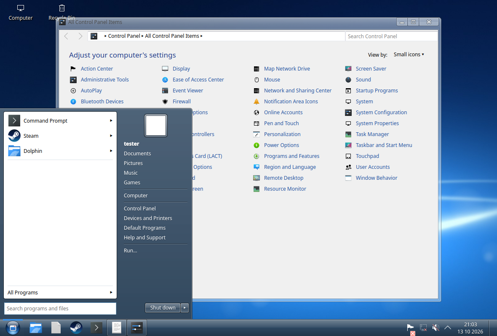
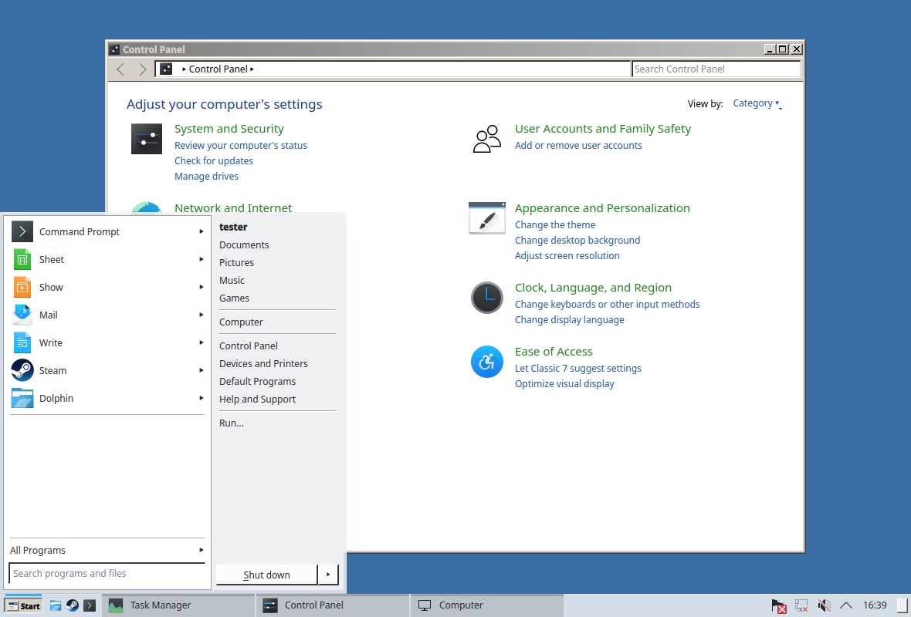
</p>

*Taken by the automatic tests in a Plasma session inside the image (it has no 3D graphics, so Aero's glass is
see-through there but not blurred; on such a computer Classic 7 draws the glass solid). The other pictures on this page come from the same tests or are drawn
off-screen by the programs themselves; the right-click menu picture is a mockup.*

## What you get

| Area | Details |
|---|---|
| Looks | **Aero** (new accounts): glass window borders and taskbar in the colour you choose, the round Start orb, task buttons with icons and pinned programs, Aero Peek, its own wallpaper. **Basic**: the same in opaque light blue. **Classic**: grey bevels, blue gradient title bars, Start button, Quick Launch, task buttons with text, classic blue desktop. Switch in Personalization |
| Window borders | Aero and Basic: own KWin decorations `classic7aero` and `classic7basic` (QML, run by Aurorae) laid out like Windows 7: buttons hanging from the top edge, icon and title lower in the title bar, a soft light behind the title on glass (blurred by KWin; drawn solid when the graphics can't blur). Classic: the Aurorae theme `Classic7` (pixel-drawn buttons) |
| Taskbar & popups | Own Plasma styles `classic7-aero` (see-through), `classic7-basic` and `classic7` |
| Colours | `Classic7Aero` colour scheme (Windows 7 colours) and `Classic7` (Windows Standard palette) |
| Apps | Aero and Basic: Kvantum style `Classic7Aero` (Windows 7 buttons, tabs, scroll bars, menus) and GTK theme `Classic7Aero`; Classic: Qt "Windows" widget style and GTK `Classic7` (Chicago95 recoloured to the Windows Standard palette) |
| One look | No dark mode, no login splash; the other Global Themes Bazzite/Fedora ship (Fedora, Valve, Air, Oxygen, Breeze Dark/Twilight) are removed, Breeze stays as the fallback |
| Icons / cursors | Breeze icons (desktop icons 32 px); Breeze Light cursors (Aero, Basic) or Chicago95 standard cursors (Classic) |
| Start menu | Windows 7 layout: pinned and recent programs with jump lists, **All Programs** (with Accessories and System Tools), *Search programs and files*, Documents/Pictures/Music/Games, Computer, Control Panel, Devices and Printers, Run...; **Shut down** with Switch user, Log off, Lock, Restart, Sleep, Hibernate; links, power button and recent count chosen in Taskbar and Start Menu Properties |
| Taskbar and windows | Windows 7 right-click menu (Cascade, Stacked, Side by side, Start Task Manager, Lock the taskbar, Properties), **Taskbar and Start Menu Properties**, Show desktop button with Aero Peek, Windows 7 Alt+Tab (Aero or Classic), Aero Shake (and Win+Home), Win+Up/Down, snap to edges, Pin to Taskbar |
| Explorer | Dolphin set up like Windows Explorer: navigation pane, Back/Forward/Up with a clickable address bar, a command bar (Cut, Copy, Paste, Move to Trash, Create Folder, View Mode, Properties), Details view, no menu bar (the ☰ button has the menus), full-width status bar |
| Explorer windows | Windows 7 **Recycle Bin** (original location, date deleted, restore, empty; the desktop icon follows), **Properties** for files, folders, shortcuts and drives (General, Security, Details, Customize, Shortcut, Tools), the **copy / move / delete progress** window with time remaining and More details |
| Computer | Classic **Computer** window: drives as tiles with free-space bars (red when nearly full), grouped into hard disks, removable storage and network; opens with Win+E, from the desktop icon and the Start menu |
| Right-click menus | Windows-style: **Send to ▸** (Compressed (zipped) folder, Desktop (create shortcut), Documents, Mail recipient, Removable Disk), **Create shortcut**, **7-Zip ▸**, KDE extras hidden; desktop menu with Display Configuration and Configure Desktop and Wallpaper |
| Notification area | Clock with calendar and clock face (Date and Time settings), volume slider with **Volume Mixer**, network icon with IP details, **Action Center** flag (firewall, updates, nearly full drives, programs that stopped working) |
| Accessories | Notepad, Calculator (Standard, Scientific, Programmer), Character Map, Sticky Notes, Paint (ribbon) and **Quick Shot** instead of the Snipping Tool: Lightshot-style capture with **Ctrl+Up** or PrtSc (drag an area, draw on it, copy/save/print/e-mail) |
| Command Prompt | Terminal with a built-in assistant that asks **your own** language model (Ollama or OpenAI-compatible): plain-language questions become commands you run with one click, errors get explained, risky commands are stopped by built-in rules; offline task library; default terminal (Ctrl+Alt+T) |
| Write | Word processor in the Word 2007 style (Ribbon, page view): opens and saves .docx, .rtf and .doc, opens PDFs as editable documents, exports PDF; styles, lists, tables, pictures, headers/footers with page numbers, find/replace, spell check (Danish/English) |
| Sheet | Spreadsheets in the Excel 2007 style: opens .xlsx/.xls/.csv, saves .xlsx/.csv/PDF; about 200 functions, number formats, conditional formatting, validation, sort and filter, charts, freeze panes, printing |
| Show | Presentations in the PowerPoint 2007 style: opens .pptx/.ppsx and old .ppt, saves .pptx/.ppsx/PDF; layouts, designs, text, shapes, pictures, tables, transitions, entrance animations, full-screen slide show with pen, handouts and notes printing |
| Photo Viewer | Windows 7 Photo Viewer look: next/previous with the arrow keys, zoom, rotate and flip (JPEG turned without quality loss), slide show, delete, print, e-mail; JPEG, PNG, GIF, WebP, TIFF, HEIC, AVIF, JPEG XL, RAW, PSD... |
| 7-Zip | 7-Zip (`7z`) and the 7-Zip File Manager (Ark), with the right-click **7-Zip ▸** menu: Add to archive, Add to .7z/.zip, Extract files, Extract Here, Extract to own folder |
| Mail | E-mail and contacts in the Outlook 2007 style: IMAP/SMTP, Gmail (app password), Outlook.com (Microsoft sign-in); folders, date groups, Reading Pane with pictures blocked until allowed; messages written in Write's editor; Address Cards, vCard import/export |
| Network | Network Connections (`ncpa.cpl`) with Status and the IPv4 Properties dialog, **Map Network Drive** (SMB shares as folders that every program can use) |
| Disk Management | `diskmgmt.msc`: volumes and disk bars, drive letters mounted at every start-up (`/var/mnt/D`), format, new/delete partitions, initialize disks, check for errors, Steam libraries on NTFS drives with Proton's compatdata kept on the system disk |
| Control Panel | All items in Small icons (View by: Category, Large icons or Small icons is remembered), Windows 7 Category view and category pages, and search; items open KDE settings modules on their own (`kcmshell6`) or Classic 7 windows; `control`, `*.cpl` and `control /name ...` work in Run |
| Task Manager | Ctrl+Shift+Esc: Applications (window list through a KWin script), Processes, Services, Performance (LED meters, per-CPU history), Networking, Users; Ctrl+Alt+Del opens the blue Windows 7 security screen |
| System / Device Manager | Win+Pause System window, System Properties (rename, environment variables, System Restore = rollback), Device Manager (PCI/USB/input/monitors/disks by type, driver and status) |
| System tools | **System Configuration** (`msconfig`), **Event Viewer** over the system journal (`eventvwr`), **Resource Monitor** (`resmon`), **Performance Information and Tools** (`winsat`: Experience Index, performance issues, system health report), **Firewall** over firewalld (`firewall.cpl`), **Programs and Features** (`appwiz.cpl`) |
| Start-up and shut-down | "Starting Classic 7" start-up screen (Plymouth); Log off / Restart / Shut down show the "Logging off..." / "Restarting..." / "Shutting down..." screen |
| Screen savers | Mystify, 3D Pipes, Bubbles, Ribbons, 3D Text, Photos and Blank, with Screen Saver Settings (`scrnsave.scr`); films and games that keep the screen on hold them off |
| Classic 7 Update | One click installs the newest Classic 7, app updates and new settings for your account; settings follow automatically after a restart |
| Login screen | Follows the theme: the Windows 7 Welcome screen for Aero and Basic, the classic "Log On" dialog for Classic (SDDM themes), with the desktop's screen resolution |
| Personalization | Control Panel > Personalization (or All Programs > System > **Personalization**): the theme (Aero, Basic, Classic) with previews, Window Color (glass colour, intensity, transparency, colour mixer), the Classic colour schemes with per-item colours, font size |
| Gaming | Everything Bazzite ships (Steam, Lutris, GameMode, MangoHud, AMD/Mesa stack) + LACT for GPU fan/power control |
| Updates | Atomic: whole-system updates and rollback, rebuilt daily from Bazzite |

## One-time setup (GitHub)

From Git Bash on Windows (Git + GitHub CLI installed with `winget install --id Git.Git -e` and
`winget install --id GitHub.cli -e`), or any Linux/macOS terminal, in this folder:

```bash
./scripts/setup-github.sh     # login, signing key, public repo, secret, first upload (starts the build)
./scripts/status.sh --watch   # follow the first build (20-40 min)
```

Then make the package public once: `https://github.com/users/<you>/packages/container/fedoraclassic7/settings`
→ Danger Zone → Change visibility → Public (GitHub has no API for this). Then:

```bash
./scripts/build-iso.sh        # builds the installer ISO on GitHub and downloads it to ./output/
```

| Script | When |
|---|---|
| `scripts/setup-github.sh` | Once |
| `scripts/status.sh [--watch]` | Build state, image public or not |
| `scripts/build-iso.sh [--download\|--release]` | A new USB installer (`--release`: published as a GitHub Release) |
| `scripts/import-zip.sh <zip>` | Copy a new Classic 7 version over this repo (keeps your name, key and history) |
| `scripts/publish.sh [--regen] "msg"` | Commit + upload changes → new image build |

## Install

- **Download the installer** from [Releases](https://github.com/slqdk/FedoraClassic7/releases): the ISO comes in
  parts under 2 GB (GitHub's limit per file). Download all parts and `SHA256SUMS`, then join them: on Windows
  `copy /b Classic7-<version>.iso.part* Classic7-<version>.iso` in a Command Prompt, on Linux/macOS
  `cat Classic7-<version>.iso.part* > Classic7-<version>.iso`; the release notes say how to check the checksum.
- **Test in Proxmox first:** boot the ISO in a VM (q35, OVMF without pre-enrolled keys, 4 cores `host`,
  8 GB RAM, 64 GB disk, VirtIO-GPU).
- **Real PC:** write the ISO to a USB stick (Fedora Media Writer, Ventoy or `dd`) and install.
- **Already on Bazzite / Fedora Atomic?** Switch in place:
  ```bash
  sudo bootc switch ghcr.io/<your-github-user>/fedoraclassic7:latest
  systemctl reboot
  ```

New user accounts start with the whole Classic 7 setup in the **Aero** look. An account that existed before
keeps the Classic look (choose Aero in Personalization) and gets the colours, window borders, Explorer layout,
desktop icons (Computer, Recycle Bin) and the Classic 7 keys (Win+E, Win+R, Ctrl+Shift+Esc, Ctrl+Alt+Del,
Win+Pause, PrtSc...) at its first login on Classic 7 (Classic 7 Update's settings step; run it again with
`classic7-update --settings`). The taskbar and Start menu of such an account are not replaced by themselves:
Personalization > Explorer > *Restore Taskbar*, or System Settings > Colors & Themes > Global Theme >
*Classic 7* with **Desktop and window layout** ticked.

## Start menu, taskbar and keys

<p>
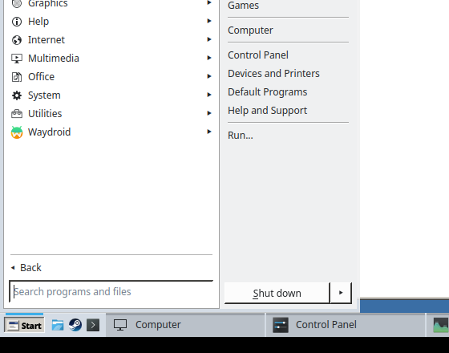 Accessories" width="49%">
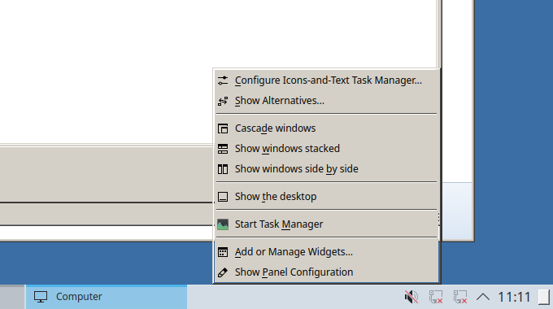
</p>
<p align="center">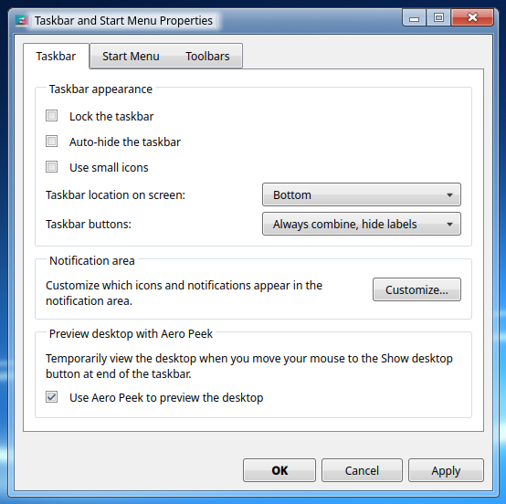</p>

- **Start menu** (the Start button or the Windows key): pinned programs at the top left, then the programs you
  used last; rest the mouse on Write, Show, Mail, Steam or Firefox for a **jump list** (recent documents,
  tasks). **All Programs** lists the folders, with Windows 7's **Accessories** (Calculator, Command Prompt,
  Notepad, Paint, Remote Desktop Connection, Run, Quick Shot, Sticky Notes, Dolphin as Explorer) and **Accessories > System Tools** (Character Map,
  Computer, Device Manager, Disk Management, Event Viewer, System Configuration, Resource Monitor, Task Manager).
  *Search programs and files* finds programs, settings, files and does sums. The right column has your name,
  Documents, Pictures, Music, Games (the Steam library), Computer, Control Panel, Devices and Printers, Default
  Programs, Help and Support and Run...; **Shut down** and the ▸ next to it (Switch user, Log off, Lock,
  Restart, Sleep, Hibernate). Right-click a program: Pin to Start Menu, Pin to Taskbar.
- **Taskbar:** in Aero and Basic, the Start orb and task buttons with icons, one per program, where programs
  stay pinned (right-click a program > Pin to Taskbar); in Classic, Start, Quick Launch icons (drag programs
  there, or Pin to Taskbar) and task buttons with text. Then the notification area, the clock and the narrow
  **Show desktop** button at the right end (Aero Peek: rest the mouse on it to look at the desktop).
  Right-click the taskbar for Cascade windows, Show windows stacked, Show windows side by side, Show the desktop,
  Start Task Manager, **Lock the taskbar** and **Properties**; right-click the Start button for Properties and
  Open Explorer.
- **Taskbar and Start Menu Properties** (`classic7-taskbar-properties`, also in Control Panel): Lock the
  taskbar, Auto-hide the taskbar, Use small icons, Taskbar location on screen (bottom, left, right, top),
  Taskbar buttons (Always combine, hide labels / Combine when taskbar is full / Never combine), the notification
  area's **Customize...** (Show icon and notifications, Hide icon and notifications or Only show notifications
  for each icon; Turn system icons on or off; Always show all icons), and Use Aero Peek. The **Start Menu** tab:
  **Customize...** (which links the right column has, large icons, the number of recent programs), the power
  button action and the privacy boxes (recent programs, recent items in jump lists). **Toolbars**: Quick Launch.
  Everything is kept in Plasma's own panel settings.
- **Run** (Win+R, or Start > Run...) takes program names, folders, files and web addresses, and the Windows
  names people type out of habit:

| Type | Opens |
|---|---|
| `cmd`, `command`, `powershell` | Command Prompt |
| `explorer`, `computer` | Explorer (Dolphin), Computer |
| `notepad`, `calc`, `mspaint`/`pbrush`, `charmap`, `stikynot`, `snippingtool`/`lightshot` | Accessories |
| `write`/`winword`/`wordpad`, `excel`, `powerpnt`, `outlook`, `photoviewer`, `7zfm` | Write, Sheet, Show, Mail, Photo Viewer, 7-Zip File Manager |
| `mstsc` (`mstsc /v:server`, `mstsc file.rdp`), `SystemPropertiesRemote` | Remote Desktop Connection, System Properties > Remote |
| `control`, `control mouse`, `main.cpl`, `desk.cpl`, `mmsys.cpl`, `timedate.cpl`, `appwiz.cpl`, `ncpa.cpl`, `firewall.cpl`, `wscui.cpl`, `sysdm.cpl` | Control Panel and its items |
| `taskmgr`, `msconfig`, `eventvwr`, `resmon`/`perfmon`, `devmgmt.msc`, `diskmgmt.msc`/`compmgmt.msc`, `msinfo32`/`winver`, `wf.msc` | System tools |
| `sndvol`, `scrnsave.scr`, `wuapp`, `shell:recyclebinfolder`, `regedit` | Volume Mixer, Screen Saver Settings, Classic 7 Update, Recycle Bin, System Settings |

| Keys | What |
|---|---|
| Win+E | Computer |
| Win+R | Run |
| Ctrl+Shift+Esc | Task Manager |
| Ctrl+Alt+Del | The Windows 7 security screen (Lock, Switch User, Log off, Change a password, Start Task Manager) |
| Win+Pause | System |
| Ctrl+Up, PrtSc / Shift+PrtSc | Quick Shot: capture an area / save the whole screen |
| Win+Up, Win+Down | Maximize; restore or minimize |
| Win+Left, Win+Right | The left or right half of the screen |
| Win+Home, or shake a window by its title bar | Minimize the other windows (again: bring them back) |
| Alt+Tab | The classic window switcher |
| Win+L | Lock |
| Ctrl+Alt+T | Command Prompt |

## Computer


Desktop icon, Start menu or **Win+E** (`classic7-computer`). Like the classic Computer page:

- Tiles grouped into *Hard Disk Drives*, *Devices with Removable Storage* and *Network Location*,
  each with a capacity bar and "X free of Y". The Bazzite system partition shows as **Local Disk (C:)**;
  boot/EFI partitions, swap and snaps are hidden.
- Double-click opens the drive in Explorer (Dolphin). Drives that aren't mounted yet (a Windows partition, say)
  are mounted first; internal disks may ask for your password.
- Right-click: Open, Open in new window, Safely Remove / Eject / Disconnect, Format..., Change drive letter...,
  Properties (with the pie chart).
- Navigation pane (Favorites, Libraries, Computer, Network), search box, and a details pane showing the
  processor and memory, or the selected drive.
- Command bar: Properties, Eject, System properties, Uninstall or change a program, Map network drive,
  Manage drives, Disconnect network drive, Open Control Panel.

`classic7-computer --list` prints what it detects.

## Explorer windows

<p>
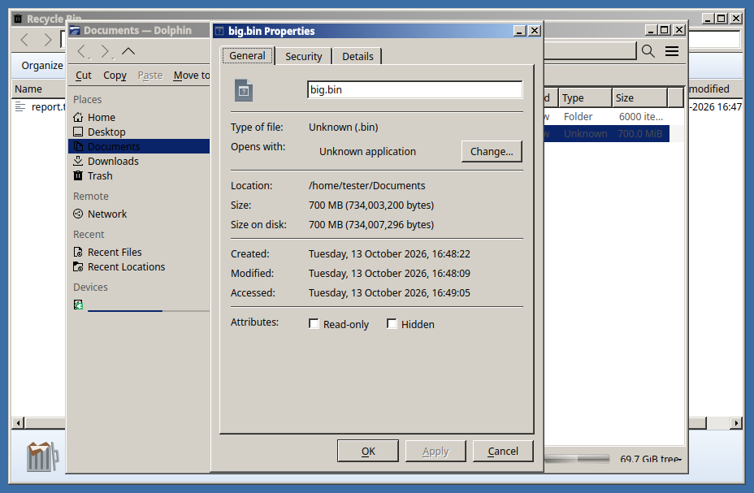
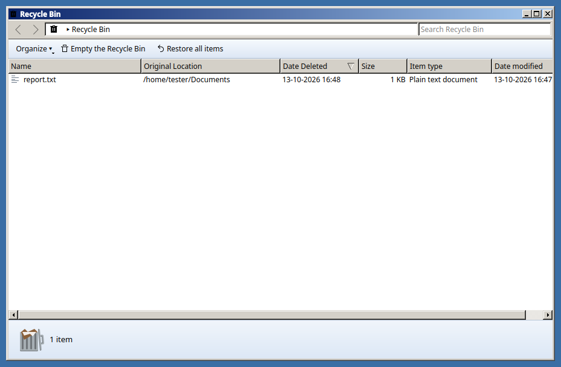
</p>

<p align="center">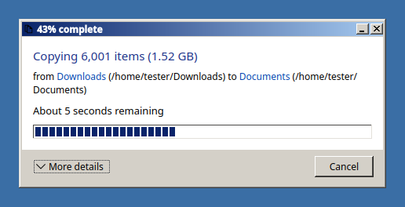</p>

- **Recycle Bin** (double-click the desktop icon, or `shell:recyclebinfolder` in Run): the deleted files with
  Original Location and Date Deleted, *Restore this item* / *Restore all items*, *Empty the Recycle Bin*, delete
  for good, and the details bar. It is the trash Dolphin and the desktop use (also on other drives); the
  desktop icon shows full or empty whoever deletes or empties.
- **Properties** (right-click > Properties, or Alt+Enter in Explorer and on the desktop): a file gets General,
  Security and Details; a folder General, Security and Customize (folder icon); a shortcut also Shortcut; a
  drive General, Tools (Check now) and Security. Read-only is the owner's write permission, Hidden puts the name
  in the folder's `.hidden` file (Explorer and the desktop hide those), and Security shows owner, group and
  everyone else with the Windows permission names. Properties of the desktop's **Computer** icon is the System
  window, as in Windows 7.
- **Copying, moving and deleting** shows the Windows 7 progress window: "43% complete", "Copying 6,001 items
  (1.52 GB) from Downloads to Documents", time remaining, a progress bar, *More details* (name, from, to, items
  remaining, speed) and Cancel. Several operations share one window; quick ones show nothing, as in Windows. The
  window's taskbar button shows the progress too.

## Right-click menus


*Mockup of the menus as Classic 7 sets them up; the exact entries depend on the file type and installed apps.*

- **Files and folders:** Open, Open With ▸, Cut, Copy, Rename, Move to Trash (Shift = delete permanently),
  **Send to ▸**, **Create shortcut**, **7-Zip ▸**, Properties. Folders also get *Open in New Window* and
  *Create New ▸*; program files (.desktop) *Pin to Taskbar*; PDFs *Edit in Write*; presentations *Show (play slide
  show)*. Hidden: Open in New Tab / Split View, Copy Location, Duplicate Here, Add to Places, Open Terminal,
  Compress ▸ and Extract ▸ (replaced by 7-Zip ▸ and Send to ▸ Compressed (zipped) folder), Share ▸ and Assign Tags.
- **Send to:** *Compressed (zipped) folder* makes `Name.zip` next to the item; *Desktop (create shortcut)* and
  *Create shortcut* make `Name - Shortcut` links (with the shortcut arrow); *Documents* and *Removable Disk* copy
  with the Windows 7 progress window and KDE's "file exists" question (a chooser appears if several USB disks are
  connected); *Mail recipient* opens your e-mail program with the files attached.
- **Empty space in a folder:** Create New ▸, Paste, Sort By ▸, View Mode ▸, Properties.
- **Desktop:** Create New ▸, Paste, Icons ▸, Refresh Desktop, **Display Configuration** (≈ Screen resolution),
  **Configure Desktop and Wallpaper** (≈ Personalize). Edit Mode, Add Widgets and Activities are hidden.

Change them in `system_files/usr/share/kio/servicemenus/` (Send to, Create shortcut, 7-Zip, Pin to Taskbar),
`system_files/usr/share/classic7/xdg-defaults/kservicemenurc` (hidden plugins, merged into
`/etc/xdg/kservicemenurc` at build time) and the `[ContextMenu]` group in
`system_files/usr/share/classic7/xdg-defaults/dolphinrc`.

## Notification area

<p>
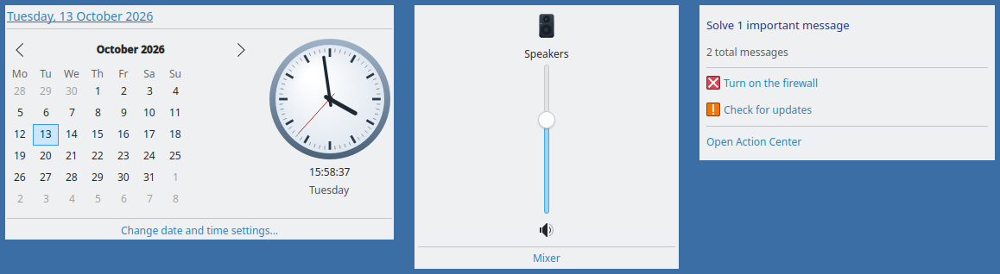
</p>
<p>
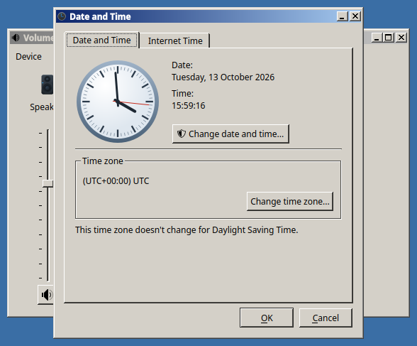
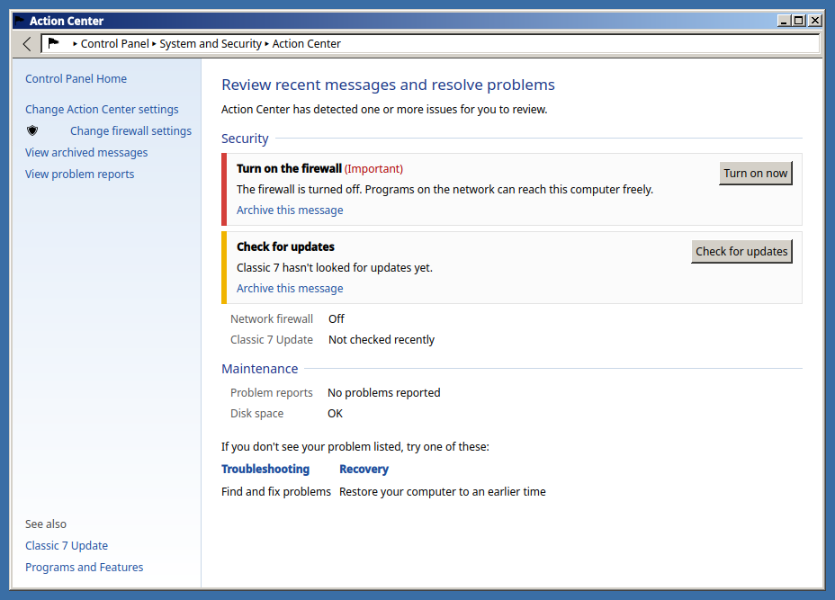
</p>

- **Clock:** click for the calendar and a clock face; *Change date and time settings...* opens **Date and Time**
  (`timedate.cpl`): date, time, time zone with the next daylight-saving change, and Internet Time. Changes go
  through `timedatectl`, which asks for an administrator password when needed.
- **Volume:** the slider with Mute and **Mixer**; the **Volume Mixer** (`sndvol`) has the speakers and one slider
  and mute button for each program that plays sound.
- **Network:** the connection with its IP address, gateway and DNS, Status, IP Settings... and Open Network
  Connections.
- **Action Center** (the flag): messages about the firewall, updates waiting for a restart or not looked for in
  a while, drives that are nearly full and programs that stopped working, each with a button to fix it;
  *Open Action Center* (`wscui.cpl`) shows them all, with archiving.

## Accessories

<p>
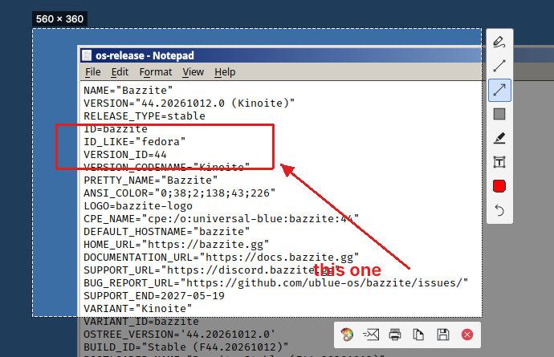
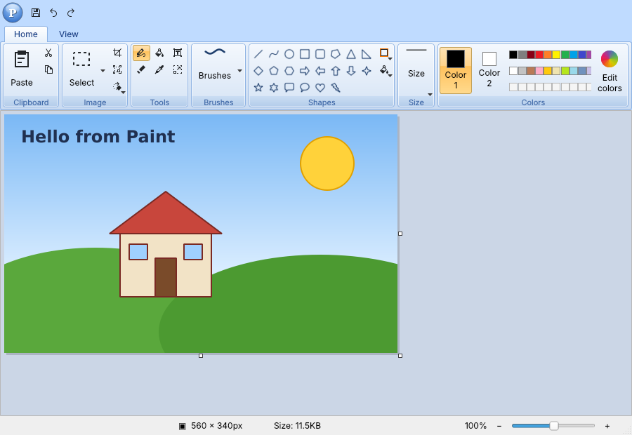
</p>

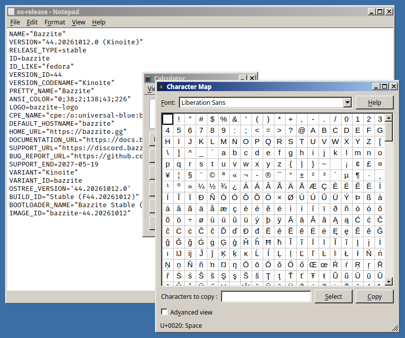

Start > All Programs > **Accessories**:

- **Quick Shot** (instead of the Snipping Tool, in the style of Lightshot): **Ctrl+Up** or PrtSc darkens the
  screen; drag over the part you want. The toolbar beside it has Pen, Line, Arrow, Rectangle, Marker, Text,
  colour and Undo (the mouse wheel changes the line width or text size); the bar under it has Open in Paint,
  E-mail, Print, Copy (Ctrl+C), Save (Ctrl+S) and Close (Esc). Shift+PrtSc saves the whole screen straight to
  the screenshot folder. Quick Shot waits in the notification area so a capture starts at once.
- **Notepad**: plain text with Word Wrap, Font, Find/Replace/Go To, Time/Date (F5), the .LOG trick,
  ANSI/Unicode/UTF-8 with Windows or Linux line ends, Page Setup with header and footer, printing, status bar.
  Text files open in Notepad.
- **Calculator**: Standard (Alt+1), Scientific (Alt+2) and Programmer (Alt+3), History (Ctrl+H), digit
  grouping, memory, the Windows keyboard keys.
- **Paint**: the Windows 7 ribbon (Clipboard, Image, Tools, Brushes, Shapes, Size, Colors), rulers, gridlines,
  full screen and zoom.
- **Character Map**: every character of a font, enlarge one by holding the mouse on it, collect characters to
  copy; Advanced view groups by Unicode subrange, searches by name and goes to a code point.
- **Sticky Notes**: coloured notes on the desktop (+ new, x delete), rich text, six colours; they come back at
  login.

## Login, start-up and shut-down

<p>
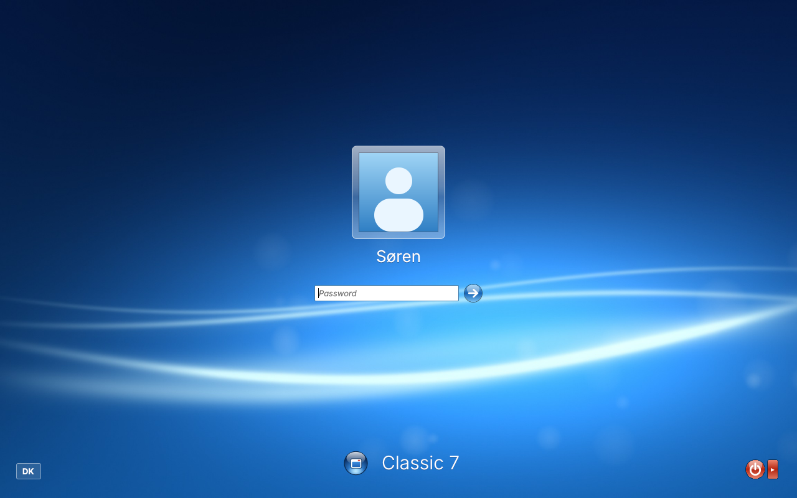
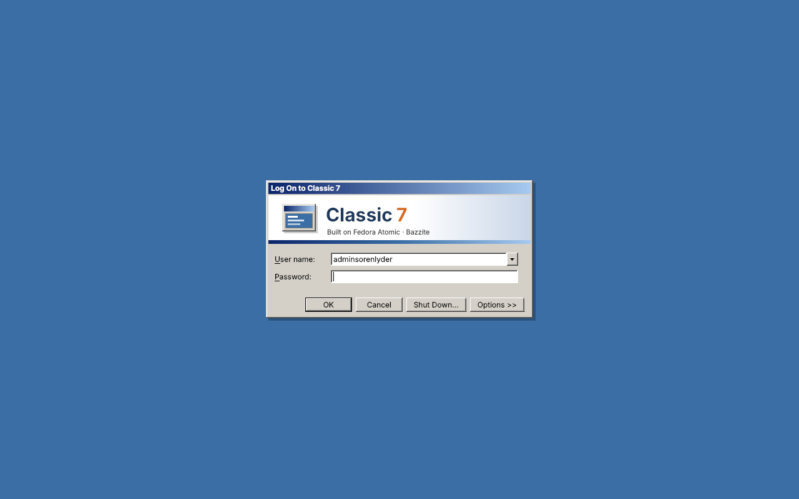
</p>

The login screen follows the theme chosen in Personalization. **Aero and Basic** have the Windows 7
Welcome screen: the account picture in its glass frame, the name and the password box with the arrow
(several accounts: their pictures first, *Switch User* goes back), "Welcome" while logging on, the red
power button with Restart, Sleep and Shut down beside it, and the keyboard layout when there are several.
**Classic** has the classic **Log On to Classic 7** dialog on the desktop blue: user name (the arrow lists
the accounts), password, *Options >>* for the session (Plasma or Steam), *Shut Down...* for shut down /
restart / sleep. The login screen also gets the desktop's **screen resolution**, refresh rate and scale
(Control Panel > Display, or right-click the desktop > Screen resolution), and its keyboard layout.

Fedora 44 replaced SDDM with Plasma Login Manager, whose look can't be changed, so Classic 7 installs SDDM
again with its own themes (`/usr/share/sddm/themes/classic7aero` and `classic7`). The desktop hands them the
theme and the screen settings after a theme change, at login and when the screen settings change
(`classic7-appearance --login-screen`, through `/usr/libexec/classic7-login-screen`; administrators aren't
asked for a password). Another SDDM theme can be picked in System Settings > Login Screen (SDDM), which then
wins.

<p>
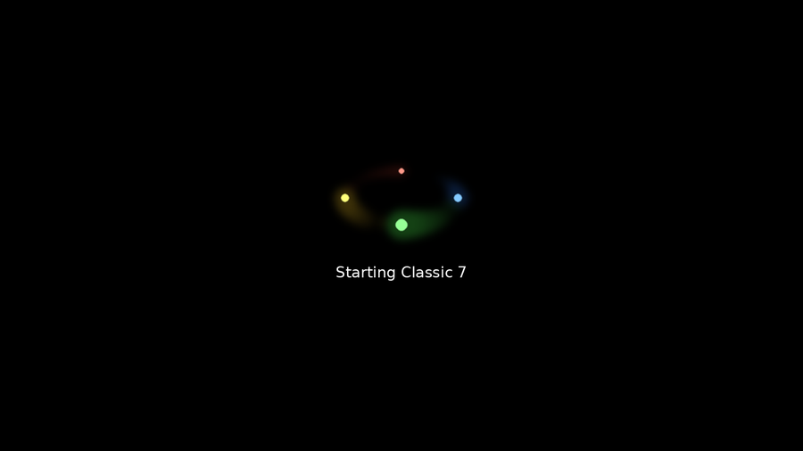
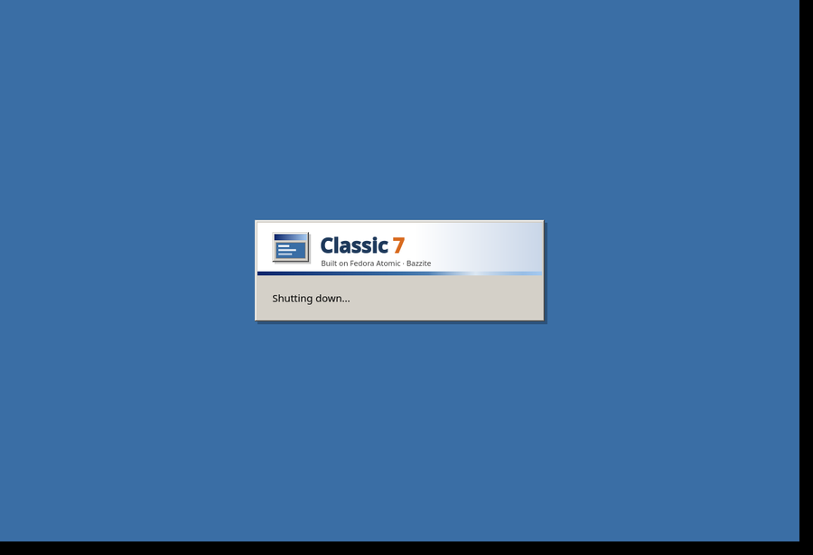
</p>

While the computer starts, a black screen with four coloured lights circling says **Starting Classic 7**
(the Plymouth theme `classic7`; the shut-down screen of the system is the same with "Shutting down..." or
"Restarting..."). **Log off**, **Restart** and **Shut down** in the Start menu, on the Ctrl+Alt+Del screen and in
Task Manager first let programs ask about unsaved work, then show the classic "Logging off..." /
"Restarting..." / "Shutting down..." screen until the session has ended; if a program cancels, the desktop comes
back.

## Screen savers

<p>
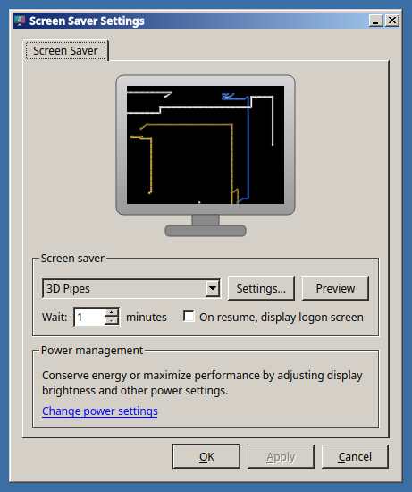
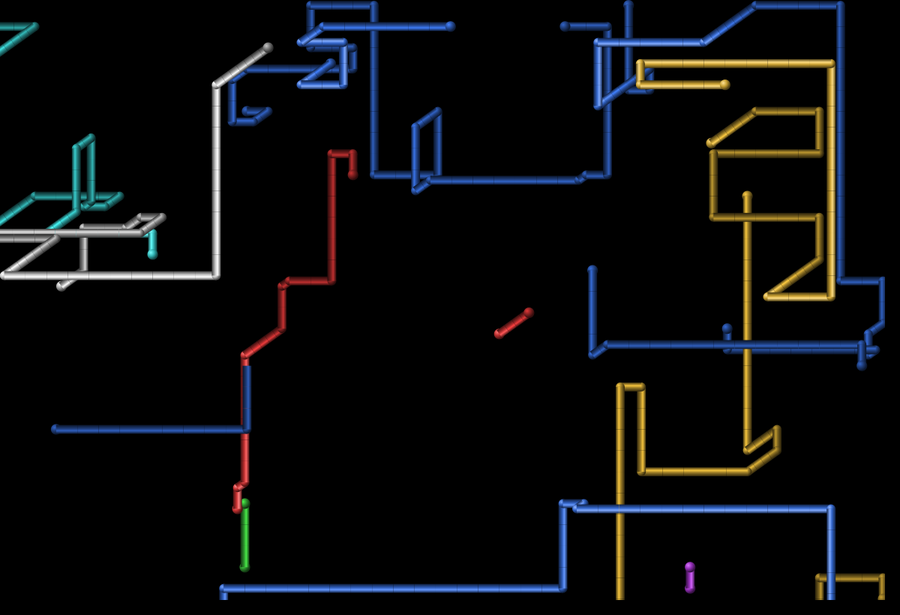
</p>

**Screen Saver Settings** (Control Panel > Appearance and Personalization > Screen Saver, or `scrnsave.scr` in
Run): Mystify, 3D Pipes, Bubbles (over a picture of your desktop), Ribbons, 3D Text (your words or the time),
Photos (a folder of pictures with cross-fades) and Blank, a preview in the little monitor, *Preview* full screen,
*Wait* in minutes and *On resume, display logon screen*. Mystify starts after 4 minutes without mouse or
keyboard (Plasma dims the screen after 5 and turns it off after 10); (None) turns it off. Programs that keep the
screen on (films, games, presentations) and full-screen windows hold the screen saver off.

## Command Prompt

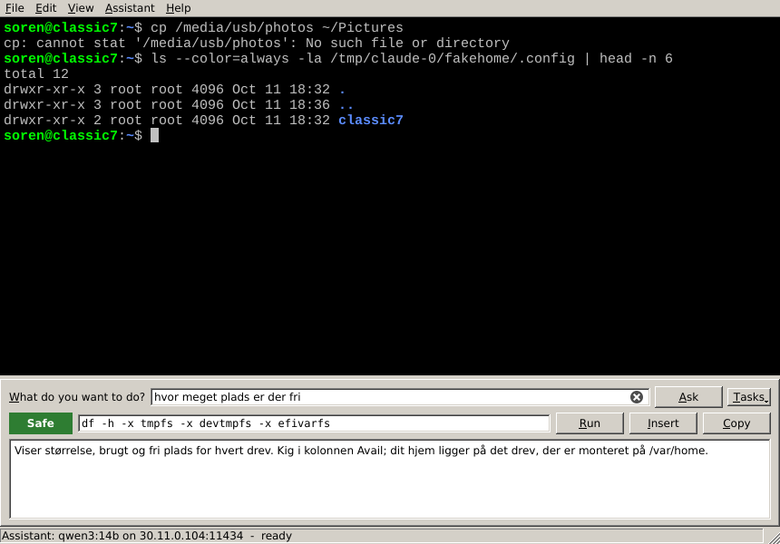

Start > **Command Prompt**, Ctrl+Alt+T, or Open Terminal (Shift+F4) in Explorer. A normal bash terminal on top
(colours, htop, nano, less work), the assistant below:

- **Ask in plain words** (Danish or English): *"hvor meget plads er der fri"*, *"install VLC"*,
  *"why can't I see my USB stick"*. You get one command, a short explanation and a risk badge.
  **Nothing runs until you click Run.** The command is editable first; *Insert* types it without Enter.
- **Risk check that doesn't trust the model:** built-in rules rate every command (Safe / Caution / DANGER).
  DANGER (`rm -rf`, `dd of=`, `mkfs`, `curl … | sh`, `git reset --hard` …) needs a tick in
  "I understand" before *Run anyway* is enabled. `dnf`/`apt` on the host are flagged with the right alternative.
- **Explain:** select text in the terminal, right-click > *Explain Selection* (Ctrl+Shift+E), or
  *Explain Last Output* (Ctrl+Shift+L). Answers stream in.
- **Knows this system:** every question carries a short description of FedoraClassic7 (Atomic image,
  Flatpak/brew/Distrobox, `classic7-update`, `ujust`, mount points, current folder), so suggestions fit.
- **Tasks** menu: ~35 ready commands (updates, programs, disks, USB, GPU, logs, network) that work without
  the model; when the server can't be reached, matching tasks are offered instead.
- **Settings** (Assistant > Settings): server address (default `http://30.11.0.104:11434`), Ollama or
  OpenAI-compatible, API key, model (automatic picks qwen3 / qwen2.5-coder / llama3 …, skipping embedding
  and vision models), answer language, font size. Stored in `~/.config/classic7/prompt.json`;
  a system-wide default can go in `/etc/classic7/prompt.json`.

Command line: `classic7-prompt --check`, `--set-server http://IP:11434`, `--set-model qwen3:14b`,
`--ask "find big files"`, `--tasks usb`, `-e COMMAND`, `--workdir DIR`, `--hold`.
Konsole is still installed (File > Open Konsole Here).

## Write

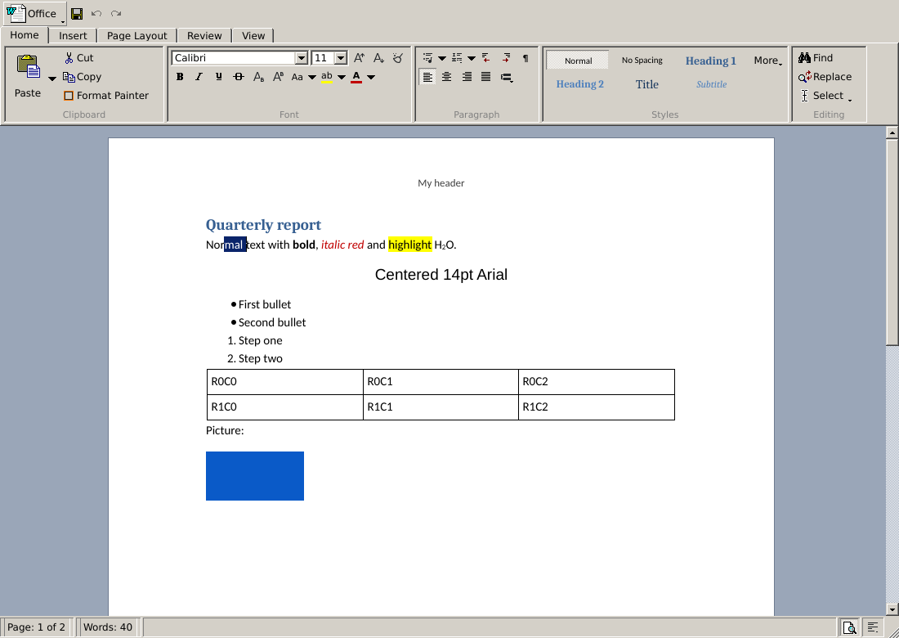

Start > **Write** (`classic7-write [FILE...]`, `winword` in Run), or double-click a Word file (Write is the default
for .docx, .doc and .rtf). Our own word processor laid out like Word 2007: Office button, Quick Access Toolbar,
Ribbon, pages on a grey background.

- **Home:** clipboard, Format Painter, font/size, bold/italic/underline/strike, sub/superscript, change case,
  text and highlight colour, clear formatting; bullets, numbering, indents, alignment, line and paragraph spacing,
  show ¶; Quick Styles (Normal, No Spacing, Heading 1-3, Title, Subtitle, Quote …); Find, Replace, Select.
- **Insert:** page break, table (grid picker or dialog), picture (also paste/drag), hyperlink, header, footer,
  page number, date and time, horizontal line, symbol.
- **Page Layout:** margins, orientation, size (A4, Letter, A5, Legal …), breaks, Page Setup dialog.
- **Review:** spelling (hunspell, Danish and English), word count. **View:** Print Layout / Draft.
- Right-click: spelling suggestions, table rows/columns, picture size, links, styles.
- **Files:** opens .docx, .doc, .rtf, .pdf (as an editable document; right-click a PDF > Edit in Write), .txt,
  .html; saves .docx (default), .rtf, .doc, .odt, .txt; exports PDF; prints. Calibri and Cambria are shown with
  the metric-compatible Carlito and Caladea, so line breaks match Word.

## Sheet

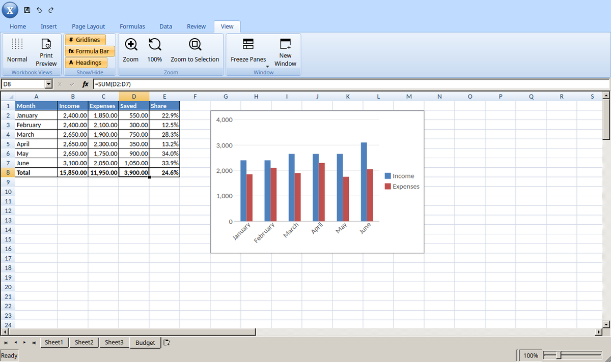

Start menu > **Sheet** (`classic7-sheet`, or `excel` in Run). Spreadsheets in the Excel 2007 layout: ribbon,
name box and formula bar (✕ ✓ fx), the grid with row and column headers, sheet tabs, and Sum/Average/Count of the
selection plus zoom in the status bar. .xlsx, .xls and .csv files open in Sheet.

- **Files**: opens .xlsx, .xlsm, .xltx, Excel 97-2003 .xls and CSV/text; saves .xlsx (macros are not kept) and CSV,
  Save As PDF. Values, formulas, styles, column widths, merged cells, freeze panes, AutoFilter, conditional
  formatting, validation, comments, hyperlinks, defined names, page setup, pictures and charts are kept.
  An old .xls is saved as .xlsx.
- **Formulas**: about 200 functions (maths, statistics, logical, text, date and time, lookup and reference
  including XLOOKUP, INDIRECT and OFFSET, financial, and the dynamic array functions SORT, FILTER, UNIQUE,
  SEQUENCE); Insert Function (Shift+F3) with help per function; AutoSum (Alt+=); F4 cycles $ references;
  click cells while typing a formula to insert references; Show Formulas (Ctrl+`); Name Manager; manual
  calculation (F9).
- **Home**: font, borders, fill and text colours, alignment, wrap, Merge & Center, number formats (Accounting,
  %, comma, decimals), Conditional Formatting (highlight rules, top/bottom, data bars, colour scales),
  Insert/Delete cells, rows, columns and sheets, Format (row height, column width, AutoFit, hide, rename, tab
  colour), Fill, Clear, Sort & Filter, Find & Select (Find, Replace, Go To). Format Cells (Ctrl+1) has Number,
  Alignment, Font, Border, Fill and Protection.
- **Insert**: charts (column, line, pie, bar, area, scatter) from the selection, moved and sized with the mouse;
  pictures, hyperlinks (Ctrl+K), symbols. **Data**: sort, AutoFilter, Text to Columns, Remove Duplicates, Data
  Validation (drop-down lists and limits). **Review**: comments. **View**: gridlines, headings, formula bar, zoom,
  Freeze Panes, new window.
- Drag the fill handle to copy or continue series (1, 2, 3; Jan, Feb; Monday; Item 1; dates); Ctrl+C/X/V with
  Paste Special (values, formats, transpose, skip blanks); copied cells paste into other programs as text and
  as a table; undo and redo for everything.
- Print and Print Preview with Page Setup: paper, orientation, margins, scale or fit to pages, print area, rows
  to repeat at the top, gridlines and headings, header and footer (&P page, &N pages, &A sheet, &F file).

## Show

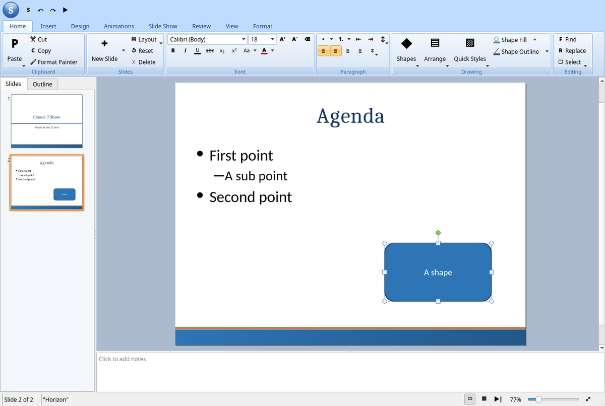

Start menu > **Show** (`classic7-show`, or `powerpnt` in Run). Presentations in the PowerPoint 2007 layout:
Slides/Outline pane on the left, the slide in the middle, notes below; Slide Sorter and zoom in the status bar.

- **Files**: opens .pptx, .ppsx, .potx, .pptm and PowerPoint 97-2003 .ppt/.pps; saves .pptx and .ppsx
  (macros are not kept), Save As PDF and pictures (PNG/JPEG of one or all slides). An old .ppt is saved as .pptx.
  A .ppsx (or right-click > *Show (play slide show)*, or `classic7-show --show FILE`) starts the slide show directly.
- **Home**: New Slide with the layout gallery, Layout, Reset, Delete; font, size, bold/italic/underline, colours
  (theme colours), bullets and numbering, list levels (Tab/Shift+Tab), alignment, line spacing; Shapes, Arrange,
  Quick Styles, Shape Fill/Outline (colours, gradients, pictures, weights, dashes, arrows).
- **Insert**: Table (grid), Picture, Shapes, Text Box, Hyperlink, Header & Footer, Date & Time, Slide Number, Symbol.
- **Design**: Page Setup (4:3, 16:9, 16:10, A4...), orientation, nine designs, theme Colors and Fonts, Background
  Styles, Format Background, Hide Background Graphics.
- **Animations**: entrance animations (Appear, Fade, Wipe, Fly In, Zoom), 20+ transitions, speed, Apply To All,
  advance on click and/or after a time. **Slide Show**: From Beginning (F5), From Current Slide (Shift+F5), Set Up
  Show (loop, range, timings), Hide Slide. In the show: arrows/space/click, B/W for black/white screen, Ctrl+P pen,
  number + Enter to jump, right-click menu, Esc ends.
- Drag shapes to move them, the handles to size and the green dot to turn them (Shift keeps proportions or 15°
  steps, Ctrl+drag copies); Ctrl+G group, Ctrl+D duplicate, Ctrl+M new slide; drop pictures from Explorer.
- Print slides, handouts (1-9 per page) or notes pages; Office button > Send > E-mail (as .pptx or PDF).

## Photo Viewer

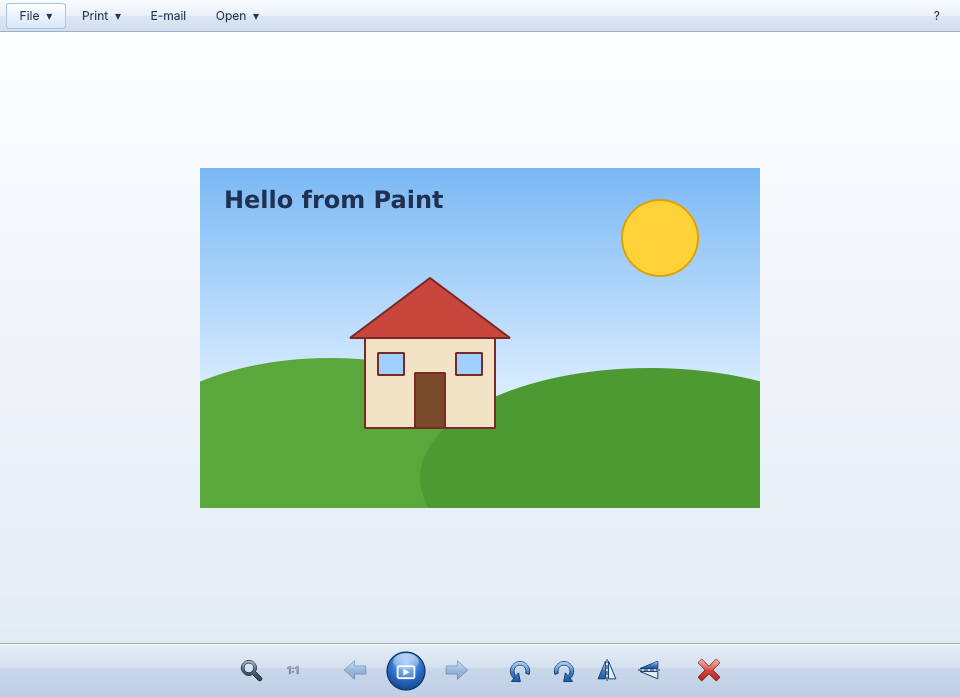

Double-click a picture (Photo Viewer is the default for pictures), or `classic7-photos [PICTURE|FOLDER]`
(`photoviewer` in Run). Left/Right go through the pictures of the folder; the mouse wheel zooms and dragging
moves; Ctrl+. and Ctrl+, turn the picture (saved when you go to the next one, JPEG without losing quality),
Ctrl+Shift+H/V flip it; F11 or F5 starts the slide show (`--slideshow`); Del moves it to the Recycle Bin, F2
renames, Ctrl+C copies, Ctrl+P prints; E-mail picks the size; Set as desktop background; Properties with
camera details.

## Mail

Start menu > **Mail** (`classic7-mail`, or `outlook` in Run). E-mail and contacts in the Outlook 2007 layout:
Navigation Pane (Favorite Folders, Mail Folders, Mail/Contacts buttons), message list grouped by date, Reading Pane.

- **Accounts** (Tools > Account Settings): own-domain IMAP/SMTP (settings found automatically, or entered by hand),
  **Gmail** with an app password (myaccount.google.com/apppasswords), **Outlook.com/Hotmail** with Microsoft sign-in.
- **Outlook.com needs an Application (client) ID** once: entra.microsoft.com > App registrations > New registration
  ("Personal Microsoft accounts"), copy the ID, Authentication > *Allow public client flows* = Yes. Mail then shows a
  code to enter on microsoft.com/devicelogin.
- Passwords and tokens live in KWallet; mail is kept locally in `~/.local/share/classic7/mail/` (headers of the newest
  2000 messages per folder; a message is downloaded when opened).
- Pictures from the Internet are blocked until you click the yellow bar (or add the sender to Safe Senders).
- New messages, replies and forwards are written in **Write's editor** (Message / Insert / Options / Format Text
  ribbon, big Send button, To/Cc/Bcc with completion from Contacts). Word attachments open in Write; Write's
  Office button > Send > E-mail attaches the open document. `mailto:` links and .eml files open Mail
  (`classic7-mail --compose [--attach FILE]` starts a new message).
- **Contacts**: Address Cards or Phone List, contact form, Address Book (Ctrl+Shift+B), vCard import/export.
- Keys like Outlook: Ctrl+N new, Ctrl+R reply, Ctrl+Shift+R reply all, Ctrl+F forward, F9 Send/Receive,
  Ctrl+Q/Ctrl+U read/unread, Ctrl+Shift+V move, Ctrl+1 Mail, Ctrl+3 Contacts, Ctrl+Enter or Alt+S send.

## Network

- **Network Connections** (`ncpa.cpl` in Run, Control Panel > Network and Internet, or the network icon >
  Open Network Connections; `classic7-network`): the adapters with Status (speed, bytes, Details) and
  Properties with the Windows **Internet Protocol Version 4 (TCP/IPv4) Properties** dialog (automatic or fixed
  address and DNS).
- **Map Network Drive** (Computer > Map network drive, or `classic7-netdrive [\\server\share]`):
  `\\server\share` becomes a folder in `~/Network` that every program can use (mounted by the kernel through
  `mount.cifs`), reconnected at sign-in; `classic7-netdrive --disconnect` / `--list`.

## Remote Desktop

<p>
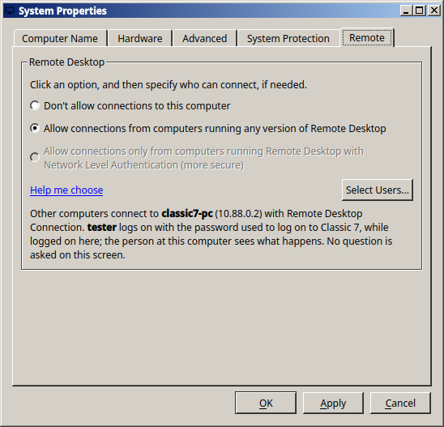 Remote" width="34%">
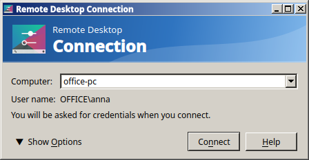
</p>

**To this PC from Windows** (Remote Desktop Connection, or any RDP client):

1. Control Panel > System > **Remote settings** (or `SystemPropertiesRemote` in Run): choose **Allow
   connections from computers running any version of Remote Desktop** and click OK. If the firewall doesn't
   let Remote Desktop in yet, Classic 7 offers to open it (an administrator password).
2. On Windows, run `mstsc` and type the address the Remote tab shows (its name or IP address).
3. Log on with the **user name and password of the account that is logged on here** (the account name the
   Remote tab shows, e.g. `soren`, and the password you log on to Classic 7 with). Capitals don't matter, and
   `COMPUTER\soren`, `soren@computer` or the account's full name work too. When Windows says the logon
   failed, Event Viewer > Application has a line from `krdpserver` saying why (the name or the password).
4. Windows says once that *the identity of the remote computer cannot be verified*: tick *Don't ask me
   again for connections to this computer* and click Yes. Classic 7 made that certificate; it lasts ten years.

What you get is the live desktop of the account that is logged on here — someone sitting at the PC sees the
same screen — not a second session as on Windows Server. So the PC must be logged on (nobody can connect
at the login screen; a virtual machine or a PC without a screen needs automatic login), and another Linux
account's password is refused while you are logged on. For a separate name and password that only Remote
Desktop accepts, click **Select Users...** > Remote Desktop settings > Add User; it shows the same desktop.
Nobody is asked on the PC's screen when someone connects, as in Windows. Turning it on writes
`~/.config/krdpserverrc` and starts KDE's Remote Desktop server (KRdp) at every login
(`app-org.kde.krdpserver.service`, with `--plasma` so KWin allows it without asking).

KRdp 6.7 refuses every login when it runs on FreeRDP 3.32, which Fedora updated to ("Your credentials did
not work" on Windows; [KDE bug 526514](https://bugs.kde.org/show_bug.cgi?id=526514)). Until Plasma ships the
fix, the image rebuilds KRdp's library with it (`build_files/krdp/fix-krdp.sh`; a build warning says if it
couldn't), together with `classic7-logon.patch`: KRdp 6.7 itself let in only the exact account name, garbled
names and passwords with æ, ø or å, and refused logons without a word in the log. Network Level Authentication (the Remote tab's third choice) isn't there with KRdp 6.7.
The clipboard works both ways; this PC's sound doesn't play on Windows, and Windows' drives and printers
aren't brought over.

**From this PC to Windows**: Start > All Programs > Accessories > **Remote Desktop Connection** (`mstsc` in
Run; `.rdp` files open in it too). Type the computer, click Connect and give the Windows user name and
password in the *Windows Security* box (*Remember my credentials* keeps them in KDE Wallet; a domain
account is `DOMAIN\user`). **Show Options** has the Windows 7 tabs: General (Save, Save As and Open .rdp
files, which Windows opens too), Display (size up to full screen, all monitors, colors), Local Resources
(sound, where Windows key combinations go, printers, clipboard, and drives or the home folder under
More...), Experience (connection speed, reconnect) and Advanced (certificate warnings, a Remote Desktop
Gateway). Ctrl+Alt+Enter switches between full screen and a window. The connection is made by FreeRDP
(`sdl-freerdp`), and its errors are shown with the Windows texts. The Windows PC must allow connections
(System Properties > Remote, Windows Pro or Enterprise; Home editions can't be connected to).

## Personalization

<p>
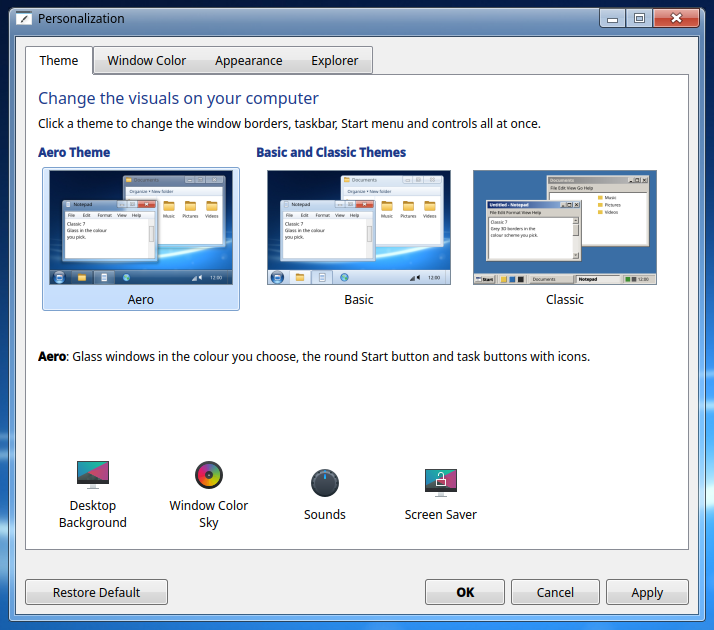
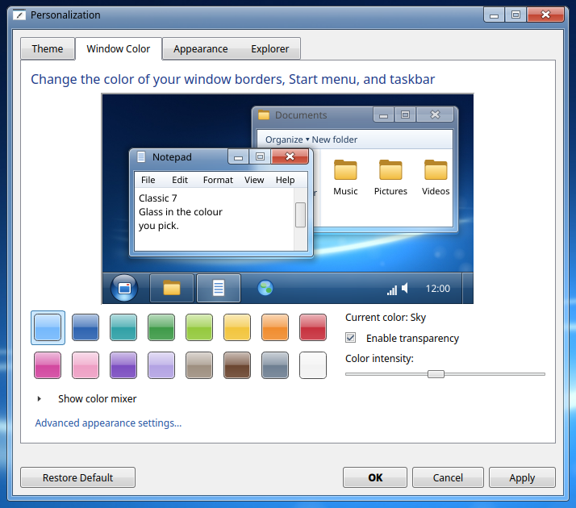
</p>

Control Panel > Appearance and Personalization > **Personalization**, Start > All Programs > System >
**Personalization**, or `classic7-appearance`:

- **Theme:** click **Aero**, **Basic** or **Classic** (each picture is drawn with your colours) and Apply. Window
  borders, taskbar, Start menu, Show desktop button, Alt+Tab, wallpaper, cursors and the controls of Qt and GTK
  programs change together. Going between Aero/Basic and Classic changes the taskbar too: Aero and Basic keep
  programs pinned on icon-only task buttons, Classic has Quick Launch and task buttons with text (the pinned
  programs move across). Desktop Background, Window Color, Sounds and Screen Saver along the bottom open their
  settings.
- **Window Color** (Aero): 16 glass colours, *Enable transparency*, *Color intensity* and a colour mixer (hue,
  saturation, brightness), with a preview drawn by the theme code. A colour other than the default draws your own
  copy of the glass theme in `~/.local/share`. Without 3D graphics (KWin can't blur, as in many virtual machines)
  the glass is drawn solid, as Windows 7 falls back to Basic; it is checked again at each login.
- **Appearance:** the Classic theme's colour schemes, like the classic Display Properties > Appearance page:
  - **Color scheme:** Classic 7 Standard, XP Blue, Seven Basic, Eleven Light (rounded corners, flat title buttons), Classic Grey, Slate, Sandstone, Terracotta, Pine, Night, High Contrast, plus your own (*Save As…*). The layout stays the same; only colours (and for Eleven Light the window corners and title buttons) change.
  - **Item / Color 1 / Color 2 / Text:** Desktop, Active and Inactive Title Bar (two-colour gradient), 3D Objects, Window, Selected Items, ToolTip. Bevel shades follow the 3D Objects colour.
  - **Font size:** Normal, Large, Extra Large; used by every theme.
- **Apply** changes your account live. Open programs get the new controls (and GTK apps such as Firefox, Steam
  and Lutris the new colours) when they start again. **Restore Default** works on the tab you are on: Aero, the
  Sky glass colour, or Classic 7 Standard.
- **Explorer tab:** *Use Classic 7 Explorer Layout and Menus* applies the Classic 7 Dolphin layout and right-click
  menus to your account (old files kept as `.bak`; the desktop menu changes at the next login); *Restore Taskbar*
  builds the taskbar and Start menu of the theme in use again.

Command line: `classic7-appearance --look aero|basic|classic`, `--glass Ruby` (a name from `--list`, or
`#RRGGBB`), `--intensity 0-100`, `--transparency on|off`, `--apply Night --size Large` (a Classic scheme),
`--reset` (Classic 7 Standard), `--explorer`, `--taskbar` (rebuild the taskbar), `--page color` (open the dialog
on a tab), `--dry-run`.

## Programs and Features

Control Panel > Programs > **Uninstall a program** (`appwiz.cpl` in Run, `classic7-programs`): one list of
app store apps (Flatpak), Steam games and tools, and packages added to the system image with rpm-ostree;
publisher, install date, size and version, search, and the details bar at the bottom. **Uninstall** asks
first and shows progress; Steam games are removed by Steam (it asks itself), added packages go away at the
next restart. **Change** opens the app store or the game's page in Steam. Programs that come with
Classic 7 are part of the system image and are not listed.

## Disk Management and drive letters

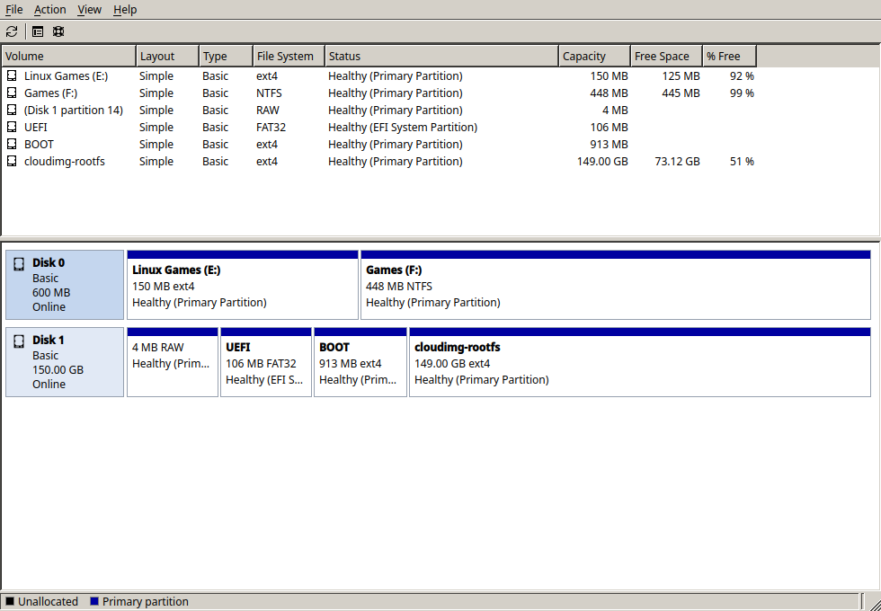

`classic7-diskmgmt` (or `diskmgmt.msc` in Run) looks like Windows 7's Disk Management. Changes go
through `/usr/libexec/classic7-disk-helper` (pkexec, `org.classic7.disk`, administrator password,
remembered a few minutes). The helper checks everything again: nothing that holds the running system,
nothing in use, and in `/etc/fstab` it only edits the entries it made itself (marked
`# classic7-drive X`); other entries for the same volume are commented out, never deleted.

A drive letter = mounted at `/var/mnt/<letter>` at start-up with `nofail` (a missing drive doesn't stop
the boot). NTFS uses the kernel's ntfs3 driver (ntfs-3g if ntfs3 is missing) with your user as owner;
FAT/exFAT the same; ext4/Btrfs get their top folder handed to you. If Windows left an NTFS drive
"dirty" (Fast Startup), the drive isn't opened and Disk Management says so; Check for Errors runs
`ntfsfix -d`.

**Use for Steam Games** makes `<drive>/SteamLibrary/steamapps`; on NTFS/exFAT/FAT it links
`steamapps/compatdata` to the one on the system disk (Valve's advice for Proton on NTFS). Then add the
folder in Steam > Settings > Storage > Add Drive.

## Control Panel, Task Manager, System

<p>
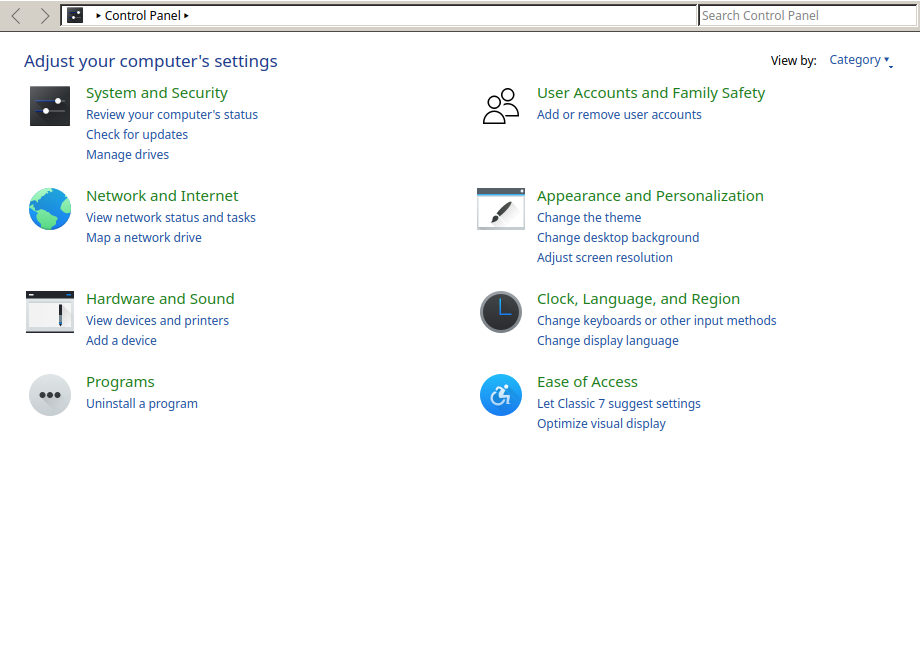
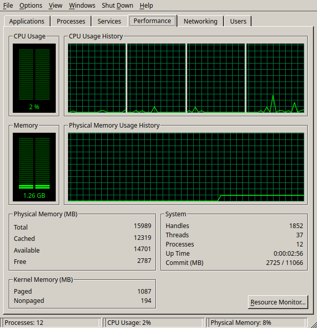
</p>
<p>
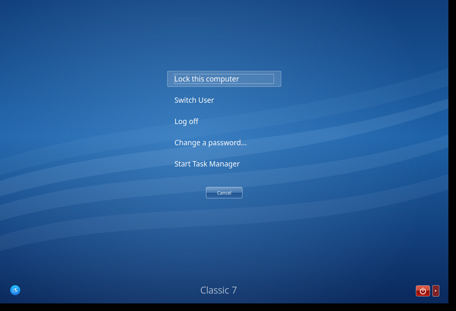
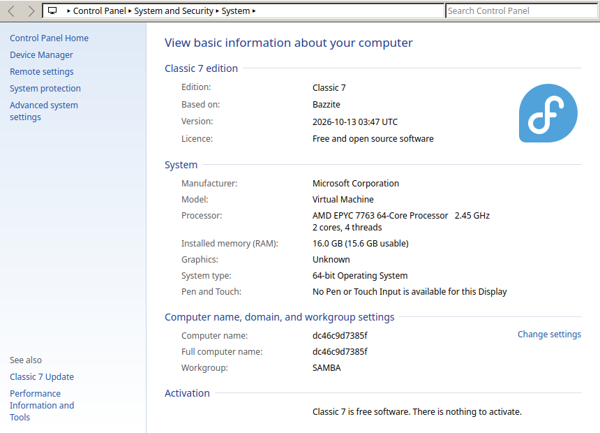
</p>

| Command | What |
|---|---|
| `classic7-control [category\|item]` | Control Panel; `classic7-control --list` lists the items this computer has |
| `classic7-taskmgr [--performance\|--processes\|...]` | Task Manager (one at a time) |
| `classic7-security` | The Ctrl+Alt+Del screen |
| `classic7-system [--properties N]` | System window / System Properties |
| `classic7-devmgmt [--list]` | Device Manager |
| `classic7-jumplist --json` | What the Start menu shows as jump lists |
| `classic7-taskbar-pin [--add\|--remove] PROGRAM`, `--list` | Pin to Taskbar from a script |
| `classic7-arrange cascade\|stacked\|side` | The taskbar menu's window arranging |

Task Manager's Applications tab and the Win+Up/Down/Home keys use KWin scripts
(`kwin_bridge.py`, `/usr/share/kwin-wayland/scripts/classic7-aeroshake`); Alt+Tab is the window
switcher `/usr/share/kwin-wayland/tabbox/classic7`; the Show desktop button is the Plasma applet
`org.classic7.showdesktop`; the taskbar menu is a small Plasma plugin built in the image
(`build_files/native/taskbarmenu.cpp`).

## System tools

<p>
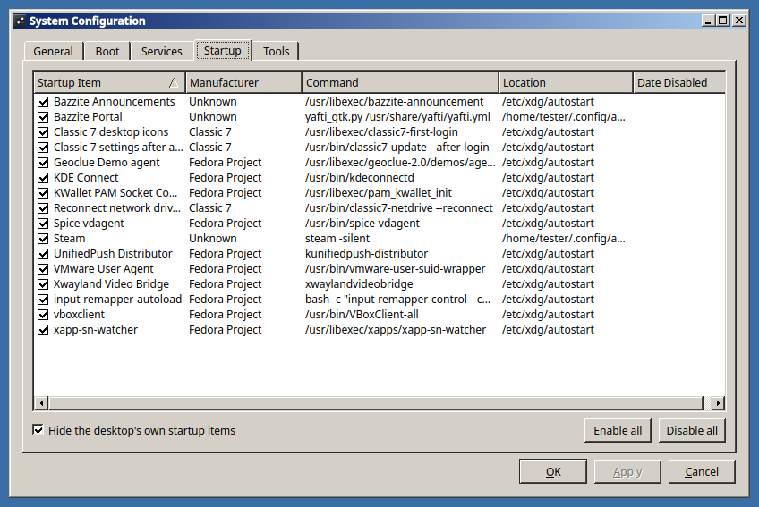
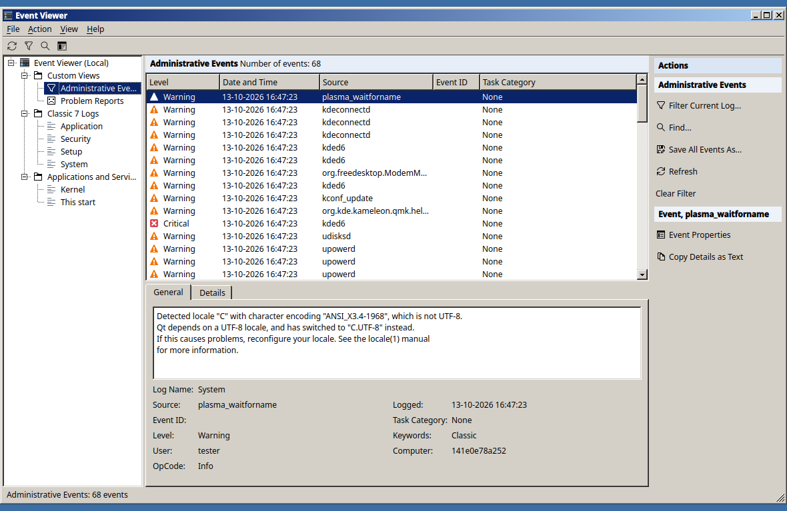
</p>
<p>
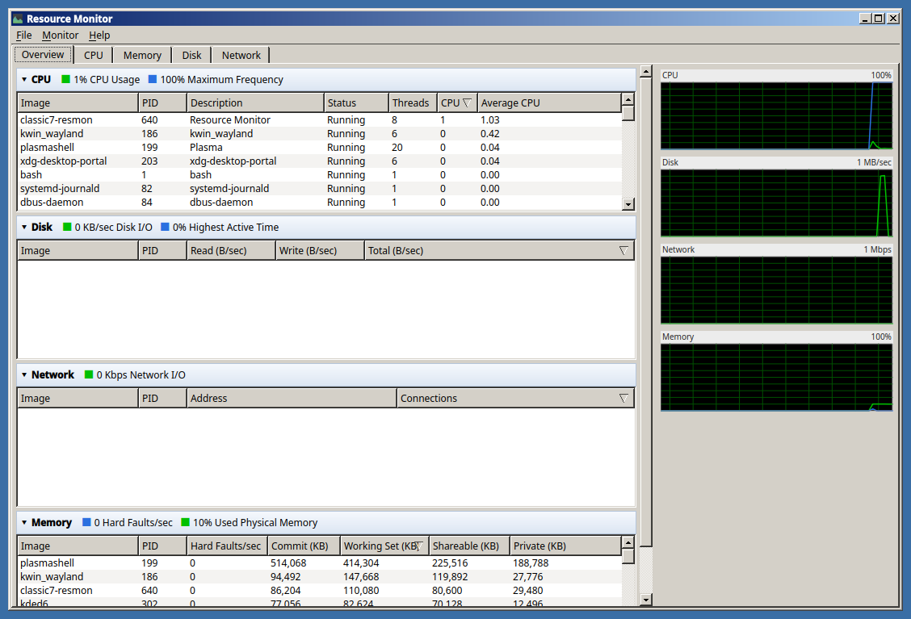
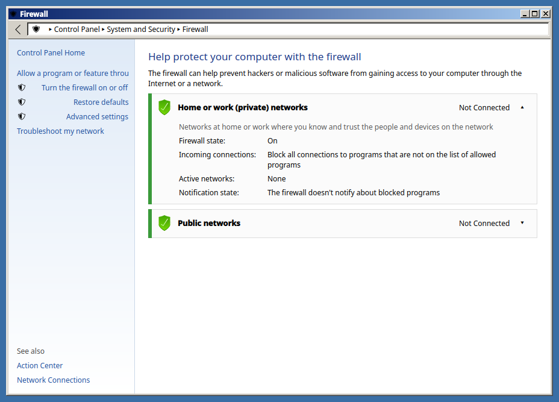
</p>

- **System Configuration** (`msconfig`): General (normal, diagnostic or selective startup), Boot (the Classic 7
  versions the computer can start, and the kernel's options), Services (the system's and your own, with their
  maker), Startup (the programs that start when you log in, with maker, command, location and the date they
  were turned off), Tools. A startup program is turned off with a copy of its .desktop file with `Hidden=true` in
  `~/.config/autostart`, as KDE's own settings do; system services change in one go through pkexec. The list
  is what a Plasma session really starts (systemd's XDG autostart rules); *Hide the desktop's own startup
  items* hides the plumbing (KDE, the wallet, location, the Xwayland video bridge, virtual machine agents,
  input-remapper, Classic 7's login helpers). Bazzite Announcements and KDE Connect are off until ticked, and
  *Normal startup* means this default set.
- **Event Viewer** (`eventvwr`, or Action Center's problem reports): the systemd journal as Windows logs —
  Administrative Events (critical, error, warning), Problem Reports (programs that crashed), Application,
  Security (sign-ins, sudo, polkit), Setup (updates), System, Kernel and This start; Filter Current Log, Find,
  Save All Events As, Event Properties.
- **Resource Monitor** (`resmon`, or Task Manager > Performance > Resource Monitor): Overview, CPU (with the
  files a process has open), Memory (with the Physical Memory bar), Disk and Network (connections and listening
  ports), each with a minute of graphs.
- **Performance Information and Tools** (`winsat`, Control Panel > System and Security, or System > Rating):
  the **Classic 7 Experience Index** scores the processor (zlib compression on one core and on all of them),
  memory (copy speed and size), graphics (a window redrawn for every picture the screen shows: does the desktop
  keep up with 60 pictures a second), gaming graphics (Qt Quick drawing 120 see-through layers off the screen,
  as fast as OpenGL can) and the primary hard disk (a 256 MB file written and read, and random 4 KB reads) from
  1.0 to 7.9; the base score is the lowest. The scores are kept in `~/.local/share/classic7/perfinfo.json` and
  marked old when the processor, memory or graphics change. **Advanced tools** lists the performance issues
  Classic 7 can see (3D drawn by the processor, NVIDIA's nouveau driver, AVX2 hidden from a virtual machine, a
  screen below its best refresh rate, low memory or disk space, failed services, crashes, a busy processor, a
  slow start-up) with a button that helps, and the system tools. The **system health report** puts the
  Classic 7 image and its digest, hardware, KWin's renderer and effects, screens, disks, network, start-up
  times, failed services, crashes, this boot's errors and KRdp's messages in one text file (no passwords,
  keys, serial numbers or MAC addresses); `classic7-perfinfo --report-text FILE` makes it without a desktop.
  *Record the desktop's drawing times* (`classic7-perfinfo --kwin-perf on|off`) sets `KWIN_LOG_PERFORMANCE_DATA=1`
  in `~/.config/environment.d` (from the next start), and the report sums up KWin's
  `~/kwin perf statistics <screen>.csv`: drawing time per picture and the time from starting it to showing it.
- **Firewall** (`firewall.cpl`, Control Panel > System and Security): on or off for home/work and for public
  networks, block all incoming connections, **Allow a program or feature** (firewalld's services
  and open ports per zone), Restore defaults. Home or work networks are firewalld's default zone, public networks
  the `public` zone. Changes go through `/usr/libexec/classic7-firewall-helper` with pkexec (administrator
  password).

## Command reference

| Command (name in Run) | What |
|---|---|
| `classic7-quickshot` (Ctrl+Up, PrtSc; `snippingtool`) | Quick Shot; `--full` saves the whole screen |
| `classic7-notepad`, `classic7-calc`, `classic7-charmap`, `classic7-stickynotes`, `classic7-paint` | Notepad, Calculator, Character Map, Sticky Notes, Paint (`notepad`, `calc`, `charmap`, `stikynot`, `mspaint`) |
| `classic7-recyclebin [--empty \| FILE...]` (`shell:recyclebinfolder`) | Recycle Bin (the freedesktop.org trash Dolphin uses) |
| `classic7-properties PATH...` | Properties; Alt+Enter in Explorer and on the desktop opens it for one item (KDE plugin `classic7_properties`) |
| `classic7-timedate [--zone]`, `classic7-mixer`, `classic7-actioncenter` | Date and Time (`timedate.cpl`), Volume Mixer (`sndvol`), Action Center (`wscui.cpl`) |
| `classic7-msconfig [--tab startup\|services\|general\|boot\|tools]` | System Configuration |
| `classic7-eventvwr [--problems]` | Event Viewer |
| `classic7-resmon [--tab overview\|cpu\|memory\|disk\|network]` | Resource Monitor |
| `classic7-perfinfo [--advanced\|--report\|--rate]` (`winsat`, `perfmon /report`) | Performance Information and Tools; without a window: `--assess` (rate the computer), `--report-text [FILE]`, `--issues`, `--json`, `--kwin-perf [on\|off]` |
| `classic7-firewall [--allowed\|--onoff]` | Firewall |
| `classic7-screensaver --settings \| --run NAME \| --list` (`scrnsave.scr`) | Screen Saver Settings, or a screen saver now |
| `classic7-goodbye --logoff\|--restart\|--shutdown` | Ends the session with the classic screen (what the Start menu uses) |
| `classic7-network`, `classic7-netdrive` | Network Connections, Map Network Drive |
| `classic7-mstsc [FILE.rdp] [/v:COMPUTER[:PORT]] [/f] [/w:W /h:H] [/edit FILE.rdp]` (`mstsc`) | Remote Desktop Connection |
| `classic7-photos [--slideshow] [PICTURE\|FOLDER]` | Photo Viewer |
| `classic7-run [TEXT]` | Run dialog, or run TEXT the way the dialog does |
| `classic7-appearance [--page theme\|color\|appearance\|explorer]` | Personalization (`--look`, `--glass`... see Personalization) |
| `classic7-taskbar-properties [--page taskbar\|startmenu\|toolbars] [--tray] [--show]` | Taskbar and Start Menu Properties; `--tray` Notification Area Icons alone; `--show` prints the taskbar's settings |
| `classic7-taskbar-pin [--remove] PROGRAM`, `--list` | Pin to Taskbar (Quick Launch in Classic, the task buttons in Aero and Basic) |

`classic7-sessiond` (a user service started before the desktop) shows KDE's file operations in the
Windows 7 progress window by taking the `org.kde.kuiserver` / `org.kde.JobViewServer` D-Bus names
before Plasma does, keeps the desktop's Recycle Bin icon right, and starts the screen saver after the
chosen idle time (`/usr/libexec/classic7-idle`, KIdleTime). The start-up screen is a Plymouth theme
made by `build_files/plymouth/make_theme.py`; the image build makes the initramfs again with it and
keeps Bazzite's initramfs if the new one doesn't check out (a build warning says so). The Accessories
folder comes from `/etc/xdg/menus/applications-merged/classic7.menu`.

## Updates on the installed PC

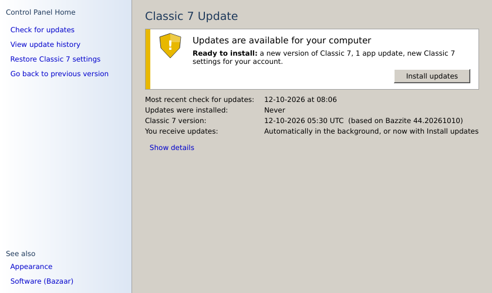

GitHub rebuilds the image daily from the newest Bazzite; the PC downloads updates in the background and
switches at the next restart. To do everything at once: **Classic 7 Update** (All Programs > System, Control
Panel > System and Security > Check for updates, or `wuapp` in Run) > *Install updates*.
One click runs all three steps:

1. **System:** the newest Classic 7 image (`bootc upgrade`), active after a restart
2. **Apps:** Flatpak apps and runtimes (`flatpak update`, unused runtimes removed)
3. **Settings:** your account gets what changed in Classic 7: the current colour scheme is re-applied with the
   new theme code, taskbar fixes, new Start menu pins, new keyboard shortcuts and the program list.
   Your own choices (scheme, pins you removed, shortcuts you changed) are kept.

After the restart into a new version, step 3 runs again by itself at login and a notification says what's new
(*View update history* lists all changes, from `/usr/share/classic7/changes.txt`).
No password is needed for checking and downloading at the computer itself, as with Windows Update
(polkit action `org.classic7.update.system` in `org.classic7.update.policy`; remote sessions must authenticate).

| Command | What it does |
|---|---|
| `classic7-update` | In a terminal: all three steps, then offer a restart. From the menu: the Update window |
| `classic7-update --check` / `--status` | Is there something new / which version runs and which is downloaded |
| `classic7-update --settings` | Only step 3: bring this account's Classic 7 settings up to date |
| `classic7-update --history` | What changed in each version |
| `classic7-update --rollback` | Back to the previous version at the next restart |

Secure Boot: install with it off, then `ujust enroll-secure-boot-key` (password `universalblue`), enrol in the
blue MOK screen and switch Secure Boot back on.

## Changing the look

Per user, use Personalization. The pictures are drawn by code, shared with the dialog:
[`classic7theme.py`](system_files/usr/lib/classic7/classic7theme.py) the Classic look (`SCHEMES[0]` is the
system default scheme), [`classic7aero.py`](system_files/usr/lib/classic7/classic7aero.py) the Aero and Basic
window borders, Plasma styles and the Start orb, [`classic7kvantum.py`](system_files/usr/lib/classic7/classic7kvantum.py)
the Kvantum theme for Qt programs, and `tools/make_wallpaper.py` the Aero wallpaper. After a change, regenerate:

```bash
pip install cairosvg          # only for the preview images
python3 tools/generate_theme.py
git commit -am "Tweak palette" && git push   # CI rebuilds the image
```

Other knobs:

| What | Where |
|---|---|
| Taskbar layout (Start, quick launch, tray…) | Classic: `system_files/usr/share/plasma/look-and-feel/org.classic7.desktop/contents/layouts/`, Aero and Basic: `.../org.classic7.aero.desktop/contents/layouts/` |
| What new accounts start with (Aero) | `system_files/etc/skel/.config/` (`classic7/appearance.json`, `kdeglobals`, `kwinrc`, `plasmarc`, `kcminputrc`, `Kvantum/`, `gtk-3.0`, `gtk-4.0`) |
| GTK look in Aero and Basic | `system_files/usr/share/themes/Classic7Aero/` |
| Start menu | `system_files/usr/share/plasma/plasmoids/org.classic7.startmenu/`; All Programs folders: `system_files/etc/xdg/menus/applications-merged/classic7.menu` |
| System-wide KDE defaults (fonts, animations, buttons) | `system_files/usr/share/classic7/xdg-defaults/` |
| Dolphin defaults / toolbars | `system_files/usr/share/classic7/xdg-defaults/dolphinrc`, `system_files/etc/skel/.local/share/kxmlgui5/dolphin/dolphinui.rc` |
| Dolphin panel layout | `tools/make_dolphin_state.py` (regenerates `etc/skel/.local/state/dolphinstaterc`, needs PySide6) |
| Start-up screen | `build_files/plymouth/make_theme.py` |
| Extra packages / services | `build_files/build.sh` |
| GTK theme recolouring, Chicago95 version | `build_files/assets.sh`, `CHICAGO95_REF` in `Containerfile` |

## Known limits

- GTK4/libadwaita apps (most GNOME apps) ignore GTK themes; Steam, Electron and Flatpak apps draw their own UI.
- No Microsoft artwork, fonts or sounds: icons, Start emblem and fonts are free look-alikes (Noto Sans).
- The login screen shows the theme and screen settings of the last administrator who logged on; other
  accounts leave it as it is. Classic colour schemes other than the standard blue don't reach it.
- Aero's glass is blurred by KWin's Blur effect, which needs OpenGL: in a virtual machine without 3D
  acceleration the glass is drawn solid instead. Aero Peek shows the desktop rather than outlines of the windows.
- Programs pick their controls when they start, so open programs keep the old ones after a theme change
  until they are started again. Taskbar and Start Menu Properties has only Quick Launch under Toolbars
  (no Address, Links or Desktop toolbars).
- Computer is its own window, not a page inside Dolphin: Dolphin's sidebar has no "Computer" entry
  (its *Devices* section lists the drives with bars instead), and opening a drive hands over to Dolphin.
- Explorer has no Libraries (the Computer window's Libraries entries open the normal folders);
  the command bar is flat buttons, not the Windows *Organize* drop-down.
- Menu order follows Dolphin: *Send to* and *Create shortcut* come after Move to Trash rather than before Cut,
  "Move to Trash" keeps its KDE name, and *Share with*, *Restore previous versions*, *Paste shortcut* and the
  desktop's *Gadgets* have no equivalent. Firefox, Steam and Electron apps keep their own menus.
- Copy conflicts ("a file with this name already exists") still use KDE's question dialog; only the
  progress window is Windows 7's. Properties for several selected items at once is KDE's dialog too.
- In GTK apps, theme images are recoloured by exact colour match, so a few shaded pixels can look off in non-grey schemes.
- Write covers the everyday Word features, not all of them: no track changes, comments, footnotes,
  text boxes, columns, tables of contents, mail merge or macros; pictures are inline only (no text wrapping);
  one header/footer per document. Old binary .doc files open with full formatting when `wv` is installed,
  otherwise as text with tables. ".doc" is saved in Rich Text Format, which Word opens normally.
- Sheet covers the everyday Excel features, not all of them: no pivot tables, macros, what-if analysis,
  sparklines, outline/grouping, sheet protection with passwords, shared workbooks or 3-D charts; a few rarely
  used functions are missing (they show #NAME?). Password-protected workbooks can't be opened.
- Quick Shot has no upload, share or "search similar images" (Lightshot sends pictures to its servers).
  Ctrl+Up is taken by Quick Shot everywhere, so programs that use Ctrl+Up themselves don't get it.
- Screen savers: a game pad doesn't count as activity (as for the screen dimming); games and video
  players that keep the screen on, and full-screen windows, are respected. "On resume, display logon
  screen" shows KDE's lock screen, and nothing is drawn over the lock screen.
- Remote Desktop to this PC shows the logged-on desktop (no separate session, no login screen over RDP),
  without Network Level Authentication, sound, or the client's drives and printers (KRdp 6.7).
- Command Prompt is a small terminal of its own: no tabs, no mouse support inside full-screen programs
  (htop/mc take keyboard only), no ligatures or sixel images. Use Konsole for those.

## Local build

```bash
just build          # needs podman + just
just build-iso      # installer ISO in ./output (needs root podman)
```

## Credits

- Base image: [Bazzite](https://github.com/ublue-os/bazzite) / [Universal Blue image template](https://github.com/ublue-os/image-template)
- GTK theme and cursors: [Chicago95](https://github.com/grassmunk/Chicago95) (GPL-3.0+/MIT), recoloured at build time; icons: Breeze (KDE)
- Window decoration, Plasma style, colour scheme, Start button: this repo (Apache-2.0, see LICENSE)
