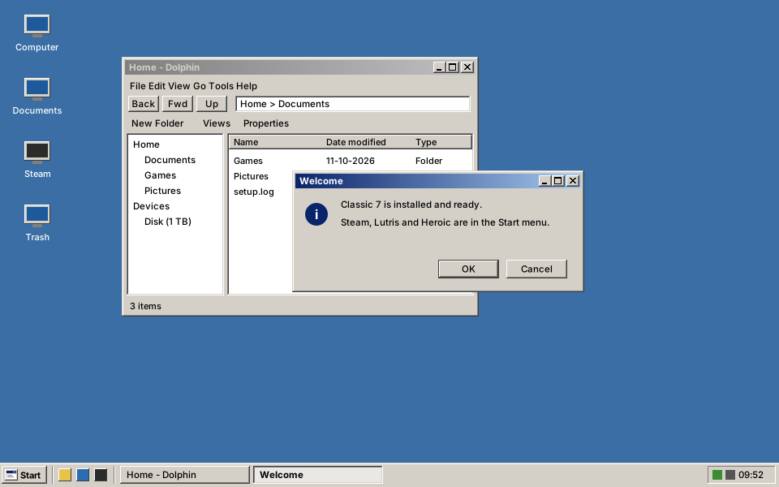
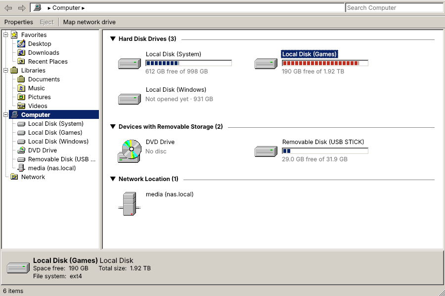
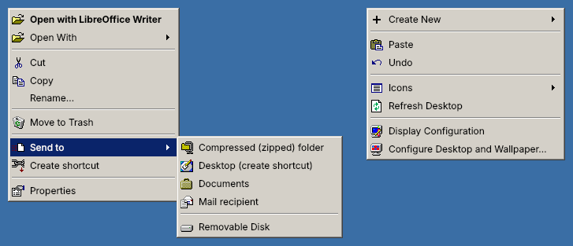
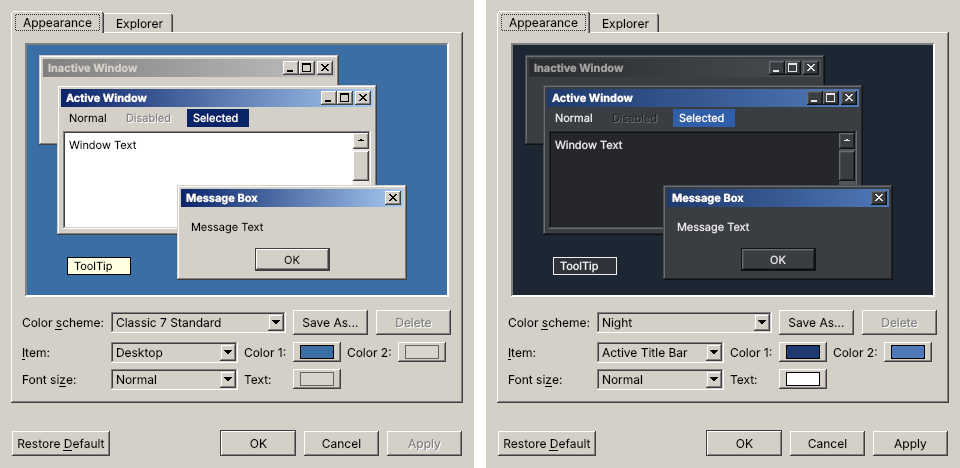

# Classic 7

A Linux desktop that looks like Windows 7 with the **Windows Classic** theme, built as an
image-based OS on top of [Bazzite](https://bazzite.gg) (Fedora Atomic + KDE Plasma, tuned for gaming).



*Mockup rendered from the theme's own palette and bevels.*

## What you get

| Area | Details |
|---|---|
| Look | Grey bevels, blue gradient title bars, Start button, quick launch, task buttons with text, tray + clock, classic blue desktop |
| Window borders | Own Aurorae theme `Classic7` (pixel-drawn min/max/close buttons) |
| Taskbar & popups | Own Plasma style `classic7` |
| Colours | `Classic7` colour scheme (Windows Standard palette) |
| Apps | Qt "Windows" widget style; GTK apps use `Classic7` (Chicago95 recoloured to the Windows Standard palette) |
| Icons / cursors | Chicago95 icons (Breeze fallback), Chicago95 standard cursors |
| Explorer | Dolphin set up like Windows Explorer: Places + folder tree, Back/Forward/Up with a clickable address bar, a command bar (Cut, Copy, Paste, Move to Trash, Create Folder, View Mode, Properties), Details view, menu bar, full-width status bar |
| Computer | Classic **Computer** window: drives as tiles with free-space bars (red when nearly full), grouped into hard disks, removable storage and network; opens with Win+E, from the desktop icon and the Start menu |
| Right-click menus | Windows-style: **Send to ▸** (Compressed (zipped) folder, Desktop (create shortcut), Documents, Mail recipient, Removable Disk), **Create shortcut**, KDE extras hidden; desktop menu with Display Configuration and Configure Desktop and Wallpaper |
| Appearance | Start > Settings > **Appearance**: classic-style dialog with colour schemes, per-item colours, font size and live preview |
| Gaming | Everything Bazzite ships (Steam, Lutris, GameMode, MangoHud, AMD/Mesa stack) + LACT for GPU fan/power control |
| Updates | Atomic: whole-system updates and rollback, rebuilt daily from Bazzite |

## One-time setup (GitHub)

From Git Bash on Windows (Git + GitHub CLI installed with `winget install --id Git.Git -e` and
`winget install --id GitHub.cli -e`), or any Linux/macOS terminal, in this folder:

```bash
./scripts/setup-github.sh     # login, signing key, public repo, secret, first upload (starts the build)
./scripts/status.sh --watch   # follow the first build (20-40 min)
```

Then make the package public once: `https://github.com/users/<you>/packages/container/fedoraclassic7/settings`
→ Danger Zone → Change visibility → Public (GitHub has no API for this). Then:

```bash
./scripts/build-iso.sh        # builds the installer ISO on GitHub and downloads it to ./output/
```

| Script | When |
|---|---|
| `scripts/setup-github.sh` | Once |
| `scripts/status.sh [--watch]` | Build state, image public or not |
| `scripts/build-iso.sh [--download]` | A new USB installer |
| `scripts/import-zip.sh <zip>` | Copy a new Classic 7 version over this repo (keeps your name, key and history) |
| `scripts/publish.sh [--regen] "msg"` | Commit + upload changes → new image build |

## Install

- **Test in Proxmox first:** boot the ISO in a VM (q35, OVMF without pre-enrolled keys, 4 cores `host`,
  8 GB RAM, 64 GB disk, VirtIO-GPU).
- **Real PC:** write the ISO to a USB stick (Fedora Media Writer, Ventoy or `dd`) and install.
- **Already on Bazzite / Fedora Atomic?** Switch in place:
  ```bash
  sudo bootc switch ghcr.io/<your-github-user>/fedoraclassic7:latest
  systemctl reboot
  ```

The Classic 7 look applies to **new** user accounts automatically. For an existing account:
System Settings > Colors & Themes > Global Theme > *Classic 7*, tick **Desktop and window layout**, Apply.
Then open **Appearance > Explorer** and click *Use Classic 7 Explorer Layout*.
New accounts also get the **Computer** and **Recycle Bin** desktop icons and **Win+E → Computer**;
for an existing account the icons appear at the next login, and Win+E can be set in
System Settings > Keyboard > Shortcuts (search "Computer").

## Computer



Desktop icon, Start menu or **Win+E** (`classic7-computer`). Like the classic Computer page:

- Tiles grouped into *Hard Disk Drives*, *Devices with Removable Storage* and *Network Location*,
  each with a capacity bar and "X free of Y". The Bazzite system partition shows as **Local Disk (System)**;
  boot/EFI partitions, swap and snaps are hidden.
- Double-click opens the drive in Explorer (Dolphin). Drives that aren't mounted yet (a Windows partition, say)
  are mounted first; internal disks may ask for your password.
- Right-click: Open, Open in new window, Safely Remove / Eject / Disconnect, Properties (with the pie chart).
- Navigation pane (Favorites, Libraries, Computer, Network), search box, and a details pane showing the
  processor and memory, or the selected drive.
- Command bar: Properties, Eject, System properties, Uninstall or change a program, Map network drive,
  Open Control Panel.

`classic7-computer --list` prints what it detects.

## Right-click menus



*Mockup of the menus as Classic 7 sets them up; the exact entries depend on the file type and installed apps.*

- **Files and folders:** Open, Open With ▸, Cut, Copy, Rename, Move to Trash (Shift = delete permanently),
  **Send to ▸**, **Create shortcut**, Properties. Folders also get *Open in New Window* and *Create New ▸*.
  Hidden: Open in New Tab / Split View, Copy Location, Duplicate Here, Add to Places, Open Terminal,
  Compress ▸ (replaced by Send to ▸ Compressed (zipped) folder), Share ▸ and Assign Tags.
- **Send to:** *Compressed (zipped) folder* makes `Name.zip` next to the item; *Desktop (create shortcut)* and
  *Create shortcut* make `Name - Shortcut` links (with the shortcut arrow); *Documents* and *Removable Disk* copy
  with KDE's progress and "file exists" dialogs (a chooser appears if several USB disks are connected);
  *Mail recipient* opens your e-mail program with the files attached.
- **Empty space in a folder:** Create New ▸, Paste, Sort By ▸, View Mode ▸, Properties.
- **Desktop:** Create New ▸, Paste, Icons ▸, Refresh Desktop, **Display Configuration** (≈ Screen resolution),
  **Configure Desktop and Wallpaper** (≈ Personalize). Edit Mode and Activities are hidden.

Change them in `system_files/usr/share/kio/servicemenus/` (Send to, Create shortcut),
`system_files/etc/xdg/kservicemenurc` (hidden plugins) and the `[ContextMenu]` group in
`system_files/usr/share/classic7/xdg-defaults/dolphinrc`.

## Appearance dialog



Start > Settings > **Appearance** (or run `classic7-appearance`). Like the classic Display Properties > Appearance page:

- **Color scheme:** Classic 7 Standard, Classic Grey, Slate, Sandstone, Terracotta, Pine, Night, High Contrast, plus your own (*Save As…*).
- **Item / Color 1 / Color 2 / Text:** Desktop, Active and Inactive Title Bar (two-colour gradient), 3D Objects, Window, Selected Items, ToolTip. Bevel shades follow the 3D Objects colour.
- **Font size:** Normal, Large, Extra Large.
- **Apply** redraws the window borders, taskbar, Start button, colours and desktop colour for your account, live.
  GTK apps (Firefox, Steam, Lutris) pick up the colours when restarted.
- **Restore Default** goes back to the system theme files.
- **Explorer tab:** applies the Classic 7 Dolphin layout and right-click menus to your account (old files kept as `.bak`; the desktop menu changes at the next login).

Command line: `classic7-appearance --list`, `--apply Night --size Large`, `--reset`, `--explorer`, `--dry-run`.

## Updates on the installed PC

GitHub rebuilds the image daily from the newest Bazzite; the PC downloads updates in the background and
switches at the next restart. By hand, in Konsole:

| Command | What it does |
|---|---|
| `classic7-update` | Update now (system, Flatpaks, firmware), offer a restart |
| `classic7-update --check` / `--status` | Is there a newer version / which version runs |
| `classic7-update --rollback` | Back to the previous version at the next restart |

Secure Boot: install with it off, then `ujust enroll-secure-boot-key` (password `universalblue`), enrol in the
blue MOK screen and switch Secure Boot back on.

## Changing the look

Per user, use the Appearance dialog. To change the **system default** for everyone, edit
`SCHEMES[0]` in [`classic7theme.py`](system_files/usr/lib/classic7/classic7theme.py) (all drawing code
lives there, shared with the dialog) and regenerate:

```bash
pip install cairosvg          # only for the preview images
python3 tools/generate_theme.py
git commit -am "Tweak palette" && git push   # CI rebuilds the image
```

Other knobs:

| What | Where |
|---|---|
| Taskbar layout (Start, quick launch, tray…) | `system_files/usr/share/plasma/look-and-feel/org.classic7.desktop/contents/layouts/` |
| System-wide KDE defaults (fonts, animations, buttons) | `system_files/usr/share/classic7/xdg-defaults/` |
| Dolphin defaults / toolbars | `system_files/usr/share/classic7/xdg-defaults/dolphinrc`, `system_files/etc/skel/.local/share/kxmlgui5/dolphin/dolphinui.rc` |
| Dolphin panel layout | `tools/make_dolphin_state.py` (regenerates `etc/skel/.local/state/dolphinstaterc`, needs PySide6) |
| Extra packages / services | `build_files/build.sh` |
| GTK theme recolouring, Chicago95 version | `build_files/assets.sh`, `CHICAGO95_REF` in `Containerfile` |

## Known limits (v0.4)

- GTK4/libadwaita apps (most GNOME apps) ignore GTK themes; Steam, Electron and Flatpak apps draw their own UI.
- Kicker's menu highlight follows the Plasma default, not the solid navy bar.
- No Microsoft artwork, fonts or sounds: icons, Start emblem and fonts are free look-alikes (Noto Sans).
- Login screen is set to the classic desktop colour; it is not themed further yet, and the Appearance dialog doesn't change it.
- Computer is its own window, not a page inside Dolphin: Dolphin's sidebar has no "Computer" entry
  (its *Devices* section lists the drives with bars instead), and opening a drive hands over to Dolphin.
- Explorer has no Libraries (the Computer window's Libraries entries open the normal folders);
  the command bar is flat buttons, not the Windows *Organize* drop-down.
- Menu order follows Dolphin: *Send to* and *Create shortcut* come after Move to Trash rather than before Cut,
  "Move to Trash" keeps its KDE name, and *Share with*, *Restore previous versions*, *Paste shortcut* and the
  desktop's *Gadgets* have no equivalent. Firefox, Steam and Electron apps keep their own menus.
- In GTK apps, theme images are recoloured by exact colour match, so a few shaded pixels can look off in non-grey schemes.

## Local build

```bash
just build          # needs podman + just
just build-iso      # installer ISO in ./output (needs root podman)
```

## Credits

- Base image: [Bazzite](https://github.com/ublue-os/bazzite) / [Universal Blue image template](https://github.com/ublue-os/image-template)
- GTK theme, icons, cursors: [Chicago95](https://github.com/grassmunk/Chicago95) (GPL-3.0+/MIT), recoloured at build time
- Window decoration, Plasma style, colour scheme, Start button: this repo (Apache-2.0, see LICENSE)
